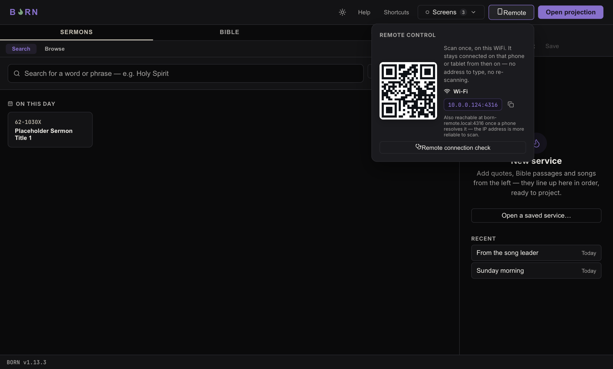
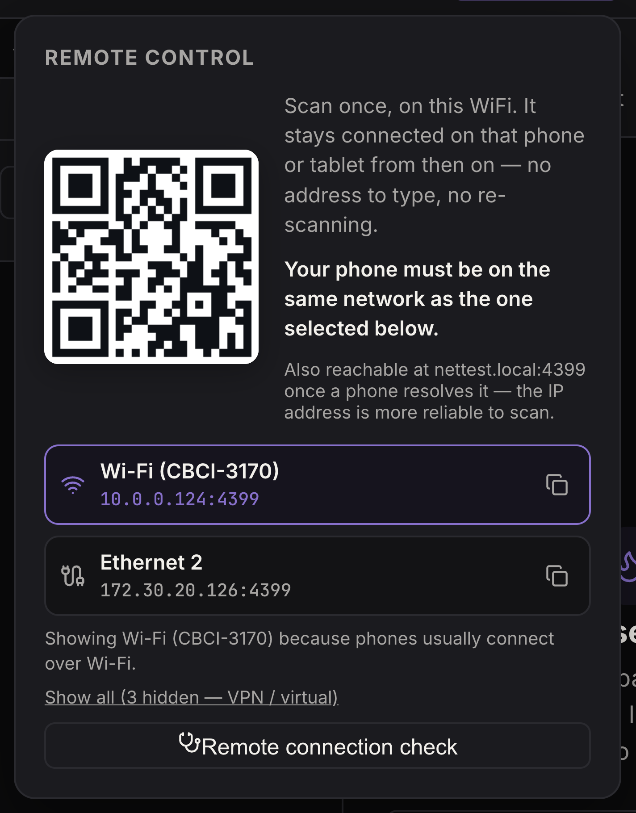
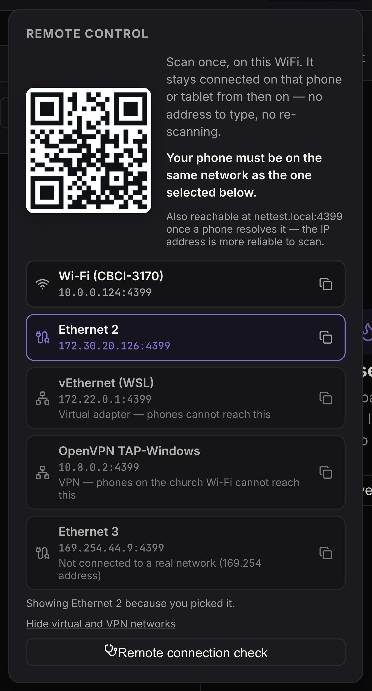
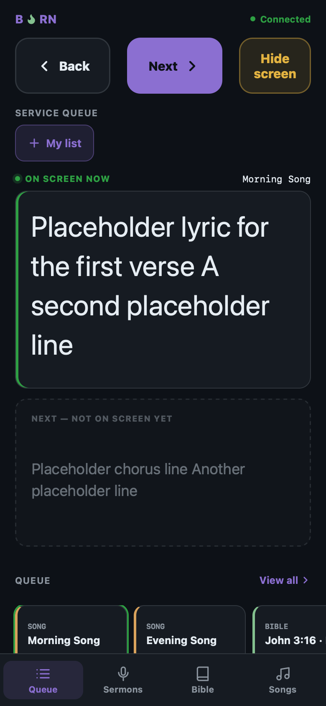
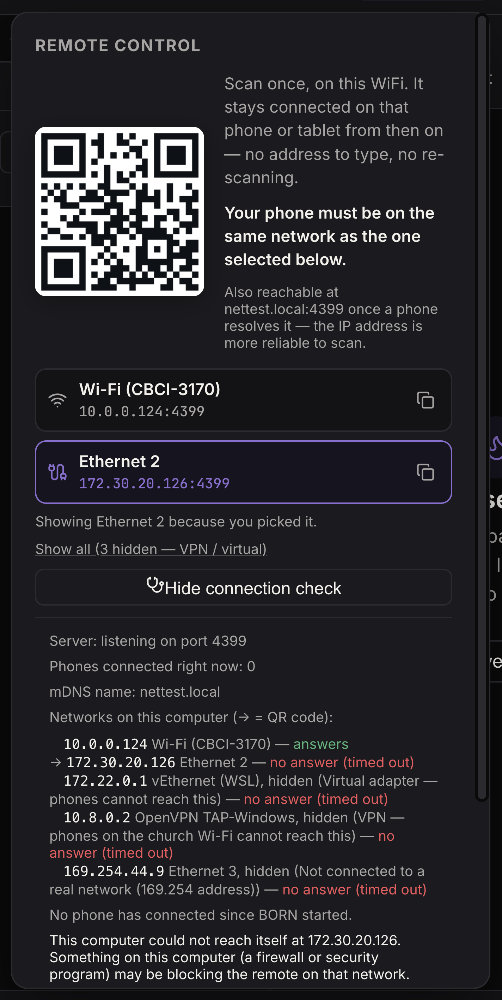

# The phone remote

A phone or tablet on the same WiFi as the BORN computer can search and advance
slides too — handy for a second operator, or for the main operator to drive from
the platform instead of a laptop.

## Connecting

1. On the BORN computer, click **Remote** in the header (top-right, between
   **Screens** and **Open projection**).

2. A QR code and an address (like `10.0.0.124:4316`) appear. **Scan the QR code
   once, on the same WiFi** — it stays connected on that phone from then on, no
   re-scanning needed. If you can't scan it, type the address shown into the
   phone's browser instead; tap the copy icon next to it to copy it exactly.
   If this computer is on more than one network, see
   [If this computer is on more than one network](#if-this-computer-is-on-more-than-one-network)
   below — the phone has to be on the network the QR code is showing.
3. The first time a phone connects, it's asked **"Who's this?"** — pick **Song
   Leader**, **Preacher**, **Operator**, or type something else under **Other…**.
   This is just a label so the operator can tell whose items are whose in a shared
   queue — no account or password is involved. Tap **Skip for now** to decide
   later.

Once connected, the remote page shows **Connected** with a green dot at the top.

## If this computer is on more than one network

Some computers are on two networks at once — for example a network cable
**and** the church WiFi. A phone can only reach BORN through the network it is
actually on, so BORN lists every network it found and lets you choose which one
the QR code is for:

- Each row shows the network's name (for WiFi, the WiFi's own name in brackets),
  its address, and a copy button. The highlighted row is the one the QR code and
  address follow.
- **To switch**, click another row. The QR code changes straight away; scan it
  with a phone that is on *that* network.
- The line under the list says why BORN picked the one it did — for example
  *"Showing Wi-Fi (CBCI-3170) because phones usually connect over Wi-Fi."* BORN
  prefers a WiFi network, then a network cable. Once a phone has connected, BORN
  remembers which network it came through and shows that one first next time.
- Networks that phones can't use — VPNs, virtual adapters (Hyper-V, WSL, Docker,
  VirtualBox) and unconnected ports — are hidden. Click **Show all** to see them:

BORN answers on **all** of this computer's networks at once, so a phone on any of
them can connect; the selector only decides which address the QR code points at.
A computer with just one network looks exactly as before — one QR code, one
address, no list.

## Using it

The remote has the same three content tabs as the desktop app — **Sermons**,
**Bible**, **Songs** — plus a **Queue** tab, along the bottom (or down the left
side, on a wider tablet). **Back**, **Next**, and **Hide screen** (**Show screen** while it is hidden) sit
at the top of every tab, so you never have to switch tabs just to advance a slide.

Anything added to the queue from a phone shows up on the desktop's Service Queue
immediately, and vice versa — it's the same live queue, shared.

Opening or importing a saved service from the phone's own Queue tab works the
same way it does from the desktop, including the song-review step if that
file has songs not yet in this computer's library — see
[Saving, opening, and sharing a service queue](sharing-queues.md). That
review always happens on the desktop, since it's the one place a decision
about your library can be made.

## If a phone can't connect

Click **Remote connection check** in the Remote popover (the stethoscope-icon
button, at the bottom of the popover). It reports:

- Whether the remote server is listening, and on which port.
- How many phones are connected right now.
- The mDNS name BORN is advertising itself as (if resolved).
- Every network BORN found on this computer (including hidden ones), which one
  the QR code is using (marked with an arrow), and whether the remote **answers**
  on each address. BORN tests this by connecting to each address itself.
- Whether any phone has connected since BORN started, and which network
  (for example `10.1.10.0/24`) it connected from.
- Plain-language hints. If no phone has connected and this computer is on more than
  one network, it says: *"Your phone must be on the same network as the address
  shown. If it cannot connect, try the other address."* — click the other network
  in the list and scan again.
- A firewall hint specific to this computer's operating system — the most common
  reason a phone on the right WiFi still can't connect is this computer's own
  firewall silently blocking the connection.

**On Windows**, the check also shows two PowerShell commands you can copy. Open
PowerShell as Administrator and run the first, `Get-NetConnectionProfile`, to see
whether each network is **Private** or **Public**. The second,
`New-NetFirewallRule …`, lets the remote through Windows Firewall on port 4316
for Private networks. If your WiFi shows as **Public**, either set it to Private
in Windows settings, or change `-Profile Private` to `-Profile Any` in the second
command. BORN never changes firewall rules by itself.

Note that "answers" only proves the remote works *from this computer* — a
firewall can still block a phone. If every address answers but a phone still
can't connect, it is almost always the firewall or the wrong network.

Click **Copy diagnostics** underneath to copy all of this as plain text, ready to
paste into a message to whoever handles tech support.

## If the connection drops mid-service

The header dot changes from **Connected** to **Reconnecting…** the moment a tap
fails to reach BORN — a dropped WiFi signal, or the BORN computer restarting —
and an amber banner says so too: *"Couldn't reach BORN — check the connection and
try again."* Nothing is lost silently; if you see that banner, the tap didn't go
through, so tap again once it says **Connected**.

You do **not** need to reopen the page or rescan the QR code — it reconnects and
catches up to whatever's currently on screen on its own, usually within a second
or two, including right after locking the phone or switching to another app and
coming back.
