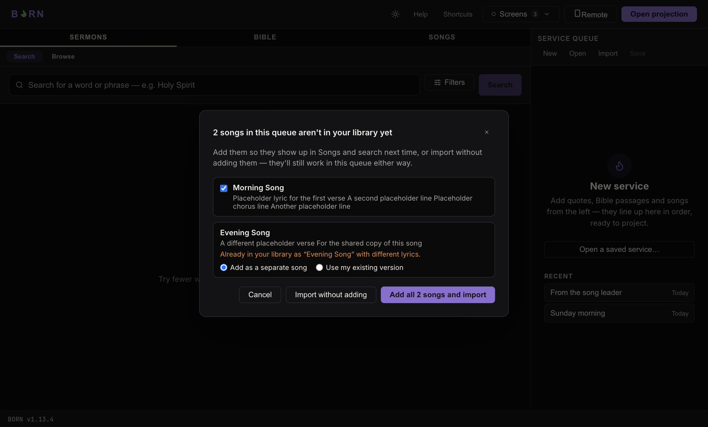

# Saving, opening, and sharing a service queue

The Service Queue panel's own toolbar — **New**, **Open**, **Import**, **Save** —
lets you save a built-up queue to a file and open it again later, or share it
with someone else who also runs BORN. This is also how a song leader who
prepares a service at home gets their songs onto the church computer.

## Save, Open, Import

- **Save** — writes the current queue to a `.born` file you choose a name and
  location for. Everything in the queue (sermon quotes, Bible passages,
  songs — full text, not just a reference) is in that one file.
- **Open** — replaces the current queue with one from a saved file. If
  something's live, the congregation screen is automatically hidden first,
  so it never keeps showing the old service's content once the queue
  underneath it has changed.
- **Import** — adds a saved file's items to the *end* of the current queue,
  instead of replacing it. Pick more than one file at once to combine
  several people's prepared lists into one queue.
- When the queue is empty, the start screen in the queue panel lists your
  **Recent** service files under **Open a saved service…** — the fastest way back
  into one you already had open.

A `.born` file is plain text (JSON) — attach it to an email, put it on a
USB drive, or send it any way you'd send a regular file.

## Sharing songs: the review step

A song leader can build their own queue at home — including songs they've
added to *their own* library that have never been on the church computer —
and a `.born` file carries each song's full lyrics with it. That's always
been enough to **project** those songs once the file is opened here. It
wasn't enough to make them *real library songs* on this computer — until now,
they'd never show up in **Songs**, never be searchable, and you'd be
starting from scratch again next week.

Opening or importing a file now checks every song in it against what's
already in your library. If everything in the file matches something you
already have, nothing changes about how Open/Import work today — no extra
step, no dialog.

If the file has songs you don't have yet, you'll see one review screen
before the import finishes:

Each song not already in your library gets its own row, with its title and
the first line or two of its lyrics so you recognize it. What you do next:

- **A genuinely new song** — a plain checkbox, checked by default. Add all
  of them with the big button at the bottom, or uncheck any you'd rather
  leave out this time (it still works in the queue either way — it just
  won't be saved to your library).
- **A song with the same title as one you already have, but different
  words** — the song leader's own version of a hymn, say. This is never
  silently treated as "the same song": you get an explicit choice, defaulting
  to **Add as a separate song** (so nothing of yours is ever overwritten).
  Pick **Use my existing version** instead if you'd rather keep what you
  already have and skip theirs.
- A song that matches one you already have — same title, same (or
  near-enough-the-same) lyrics — needs no decision at all. It's quietly
  linked to your existing copy and never shown in this list; the
  confirmation message afterward still counts it, though (see below).

At the bottom: the big button adds whatever's currently checked/chosen and
finishes the import. **Import without adding** finishes the import exactly
as it would have worked before this feature existed — every song is still
in the queue and projectable, none of them are saved to your library.
**Cancel** (or <kbd>Esc</kbd>, or the **×**) backs out completely — nothing
about the queue or your library changes at all.

Songs added this way show up in **Songs**, search, and the A–Z list right
away, survive a restart, and carry the **Imported** badge — the same one
any song you've added by hand already gets (see
[Projecting sermons, songs & scripture](content-types.md)).

Opening the exact same file again later adds nothing new and never creates
a duplicate — everything in it will already match.
