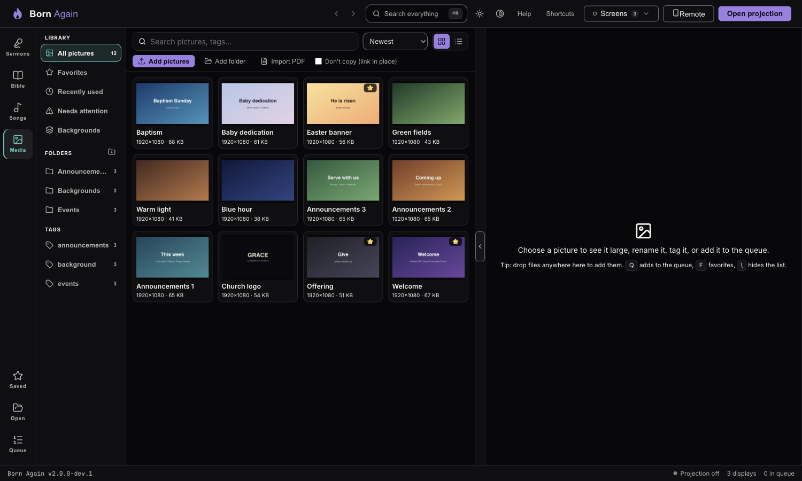
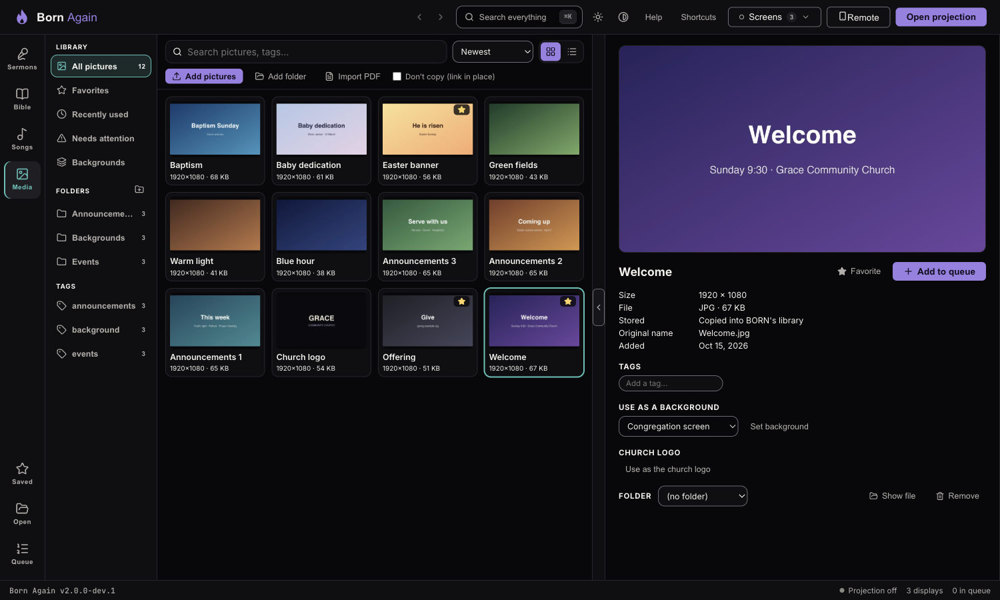

# Pictures: the Media library

The **Media** area (the fourth item on the left rail, in teal) holds every picture you might put on the screen:
announcement slides, photos, backgrounds, a church logo, pages of a PDF.

## Adding pictures

| How | What happens |
|---|---|
| **Add pictures** | Choose one or more picture files. |
| **Add folder** | Everything inside the folder (and its sub-folders) is added. Things that aren't pictures are skipped. |
| **Drag and drop** | Drop files or a folder anywhere on the Media area. |
| **Paste** | Copy a picture (or take a screenshot) and press **Ctrl+V** / **⌘V** on the Media area. |
| **Import PDF** | Turns every page of a PDF into a picture and queues them as one slideshow — see [Importing a PDF](media-on-screen.md#importing-a-pdf). |

**BORN keeps its own copy** of each picture, so a missing USB stick, a renamed folder or a moved file never
breaks a service. Your original is left alone.

> **Very large files:** tick **Don't copy (link in place)** before adding. BORN then uses the original where it is. The
> original must stay there (and its drive plugged in); if it moves, the picture shows as *missing* and BORN will
> never delete or change that original.

### What works

JPEG, PNG, GIF, WebP, BMP and AVIF — and, on **both Windows and Mac**, iPhone **HEIC** photos and **TIFF** files: BORN
turns them into a high-quality JPEG when you add them (colours corrected for the screen, rotation applied) and keeps your original
untouched. A 12-megapixel photo takes about a second; a very big 48-megapixel one a few seconds, and BORN stays usable while it works.
Nothing needs installing and it works offline. Pictures over 64 megapixels are refused with a plain message.

If a photo *still* can't be opened (a rare format), BORN says so and offers **Copy instructions**: on the iPhone choose **Share →
Options → Most Compatible** (or AirDrop with “Most Compatible”) and add the JPEG instead. The rest of a batch carries on.

BORN tells you plainly when it can't use something — *damaged*, *cut off (incomplete)*, *empty*, *a PDF* (use Import PDF),
*a video* (arrives in a later version) — and never adds a broken picture to the library.

You can also **drop a PDF** (for example a PowerPoint saved as PDF) onto the Media area, the same as **Import PDF**.

Adding the same picture twice does nothing: BORN recognises it by its contents (not its name) and says it was already there.

## Finding and organizing

- **Search** matches names, original file names and tags.
- **Folders** are yours to name. Drag a picture onto a folder to move it. Deleting a folder **never** deletes pictures.
- **Tags** — type a tag in the picture's detail pane. Click a tag on the left to see only those pictures.
- **Favorites** (star, or **F**) and **Recently used** keep what you use most one click away.
- **Needs attention** collects pictures whose file is missing, changed or unreadable, or whose drive isn't plugged in.
- **Grid or list** with the buttons at the top right (the same choice as Sermons, Bible and Songs). **`\`** hides the list so the picture can be seen larger.

## Pictures on a USB stick or network drive (linked)

A picture you **linked** (*Don't copy*) lives on its drive. If the drive isn't plugged in, the picture says **Drive not connected** — not
"missing" — and a banner at the top of the library says which drive and how many pictures. Nothing is lost:

- **Plug it in** and press **Check again**; or
- if the drive now has a **different letter** (it was **E:**, now **F:**) or the folder moved, choose **Find the folder…** and pick the
  new place — BORN finds the same pictures **by their contents** (names don't matter) and reconnects them. It changes only where they are read from;
  nothing is copied or added.
- To stop depending on the drive, open a picture and choose **Copy into library** (while the drive is plugged in).

**Check** ("Is tonight ready?") lists these pictures too, with the same **Find the folder…** button, so you find out on Saturday.

## Keyboard

| Key | Does |
|---|---|
| **← → ↑ ↓** | Move between pictures |
| **Q** or double-click | Add to the queue |
| **F** | Favorite / unfavorite |
| **Delete** | Remove from the library (with **Undo**) |
| **Ctrl/⌘-click** | Tick several pictures; then **Each to queue** or **As one slideshow** (in the order you ticked them) |
| **Menu key / right-click** | Context menu |

## Removing

**Remove from library** takes pictures out immediately and shows **Undo** (also **Ctrl/⌘+Z**). The file is erased about an hour
later. If the picture was one you linked in place, your original is **never** touched.

## Where it is stored

Inside BORN's data folder, in a `media` folder (the pictures, small previews, and `media.db`, which remembers names and
tags). To back up the library, copy that whole folder while BORN is closed.
