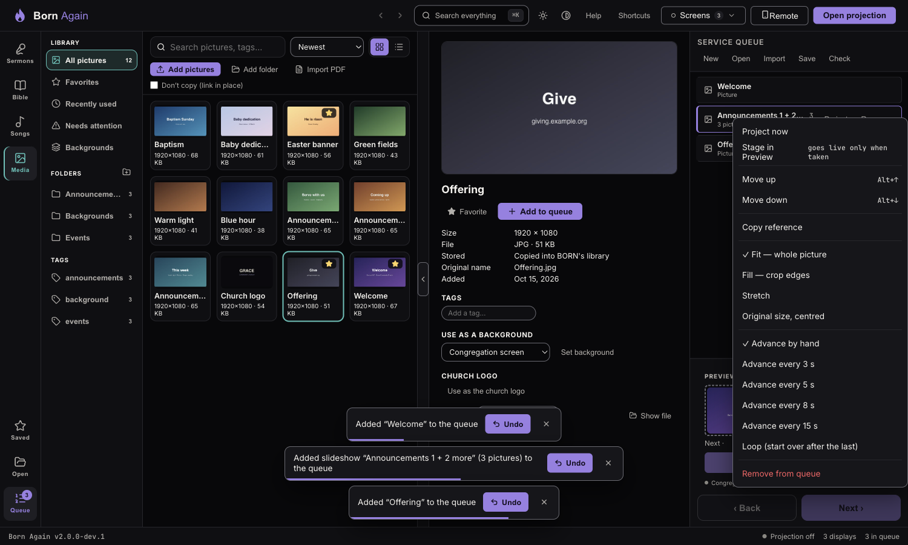
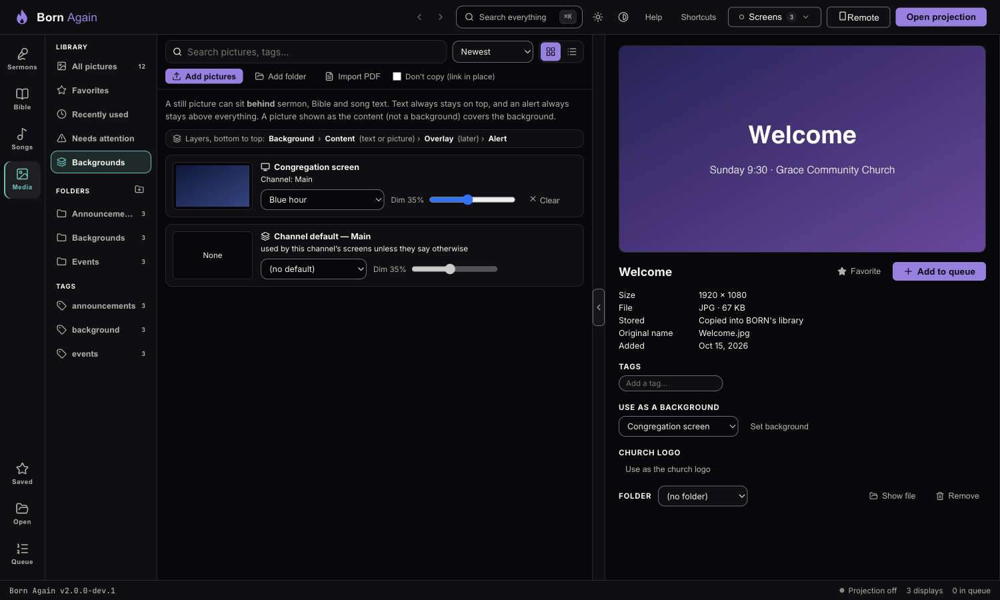
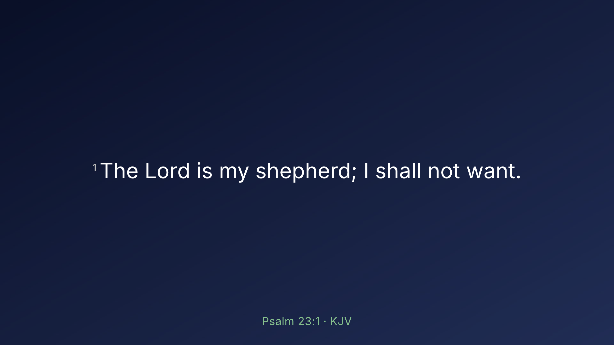
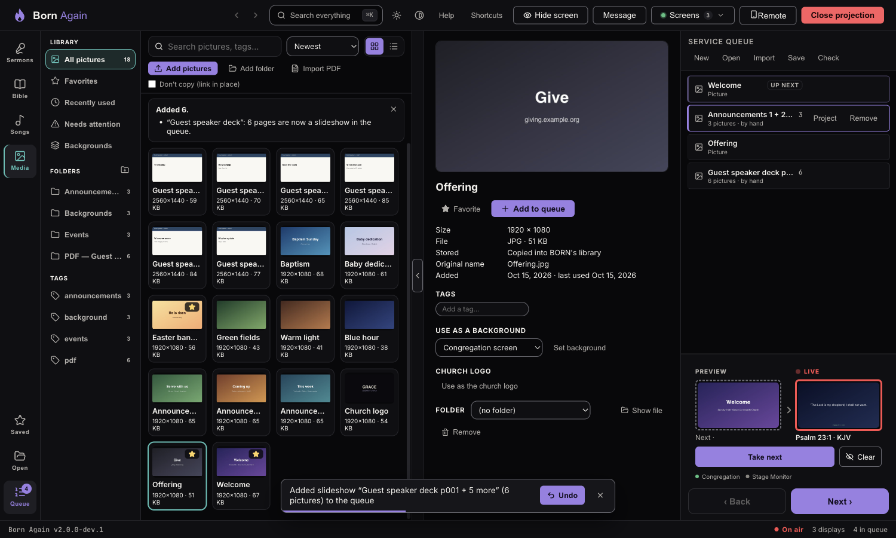

# Pictures on the screen: queue, slideshows, backgrounds, PDF, logo

## In the queue

Press **Add to queue** (or **Q**, or drag a picture onto the queue). A picture is a normal queue item: **Project** puts it
up, clicking the row stages it in **Preview**, and **Next/Back** move on. Nothing changes what is **Live** until you take it.

If a picture's file is missing when you take it, **nothing on the screen changes** and a message says why.

### Slideshows

Tick several pictures (**Ctrl/⌘-click**) and choose **As one slideshow**, or import a PDF. A slideshow is one queue item with a
slide per picture; **Next/Back** step through it. Right-click the row for:

- **Advance by hand** (the default) or **every 3 / 5 / 8 / 15 seconds** — only after *you* have taken it; it stops when you hide the
  screen or put something else up.
- **Loop** — start over after the last picture.
- **Fit** — *Whole picture* (the default, with black bars if needed), *Fill* (crops the edges), *Stretch*, or *Original size, centred*.

Changing these never affects what is on the screen right now; it applies the next time you take the item.

## Backgrounds behind text

A still picture can sit **behind** sermon, Bible and song text. In **Media → Backgrounds**, choose a picture and a dimming amount for
the **Congregation screen**, each **Graphics output**, or a **channel's default**. Text always stays on top, and an alert (the
**Message** button) stays above everything. A picture shown *as the content* covers the background.

The order, bottom to top, is always **Background → Content (text or picture) → Overlay (later) → Alert**.
Lower-third Graphics outputs (made to sit over a camera) deliberately never draw a background or a picture.

## Importing a PDF

**Media → Import PDF** draws each page as a picture (sharp on a 1440p screen), files them in a folder named after the PDF, and queues
them as a slideshow.

- A password-protected PDF is refused with a plain message — save an unprotected copy from your PDF viewer.
- PowerPoint, Keynote and Google Slides: **export to PDF first** (or export the slides as images and add them as pictures).
  Animations and embedded video aren't carried over.
- Up to 500 pages and 200 MB. **Cancel** while it is working removes anything it had added.

## Panic: Esc, and the logo key

- **Esc** (or **B**) blanks the screen at once. It also cancels anything still *loading* — a big picture can never appear a moment
  after you blanked. Press again to bring back what was there.
- **Ctrl/⌘ + Shift + L** puts the **church logo** on the screen. Set it once: open a picture in Media and choose **Use as the church logo**.
  With no logo set, the key just blanks the screen and tells you.

Both keys work from the Congregation and Stage windows as well.
