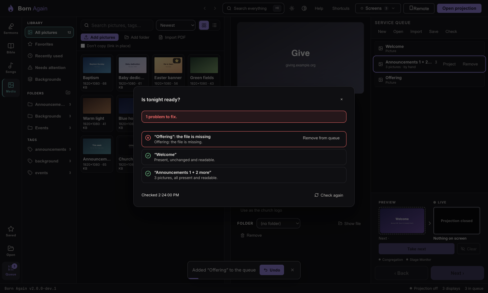
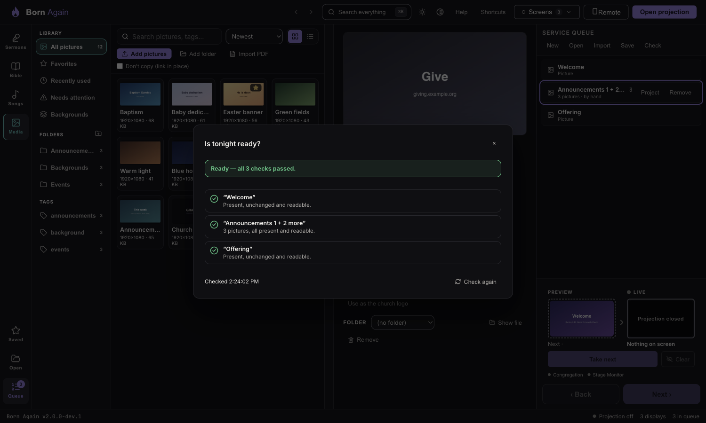

# Is tonight ready? Preflight, and sharing a service with pictures

## Preflight — "Is tonight ready?"

Press **Check** at the top of the queue (or **Ctrl/⌘+K → Check that tonight's service is ready**). BORN looks at every item:

| Check | Why |
|---|---|
| The file is there | A moved or unplugged file is found tonight, not on stage |
| It is **byte-for-byte what was added** | Catches a half-copied or damaged file that is still the right size |
| It really **opens** as a picture | |
| A large picture's **screen-sized copy** is built now | So the first Take is instant |
| Sensible size; animated or linked-in-place noted | |
| Background pictures, free disk space, Graphics outputs that won't draw pictures | |
| Items made by a newer BORN, or damaged ones | They will be skipped |

Each line says **pass**, **look at this**, or **fix this**, with the one thing to do — **Find the file…** for a linked picture, **Remove
from queue** otherwise. The check changes nothing by itself.

## Sharing a service that has pictures

When you **Save** a service, each picture is written by what it *is* (a fingerprint of its contents), with its name and size —
the pictures themselves are not inside the file. When someone **opens** or **imports** it on another computer:

1. Pictures that computer already has are matched silently, whatever they are called.
2. If some are missing, BORN shows **one** review: **Find the pictures…** (choose a folder or USB stick — BORN finds the right files by
   contents and adds only those), **Open anyway** (they show as missing; the check lists them), or **Cancel — change nothing**.
3. Cancel really changes nothing.

An older BORN opens such a file safely: pictures appear as readable rows saying they were made by a newer version.
Bundling the pictures inside the file arrives in a later version.
