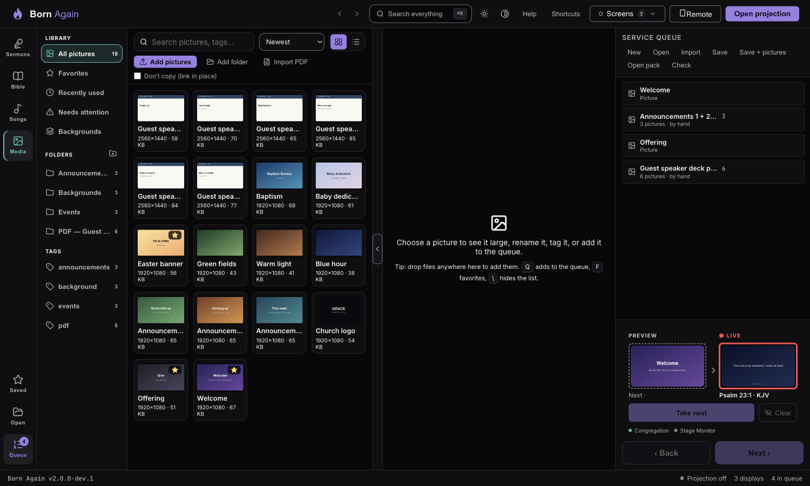
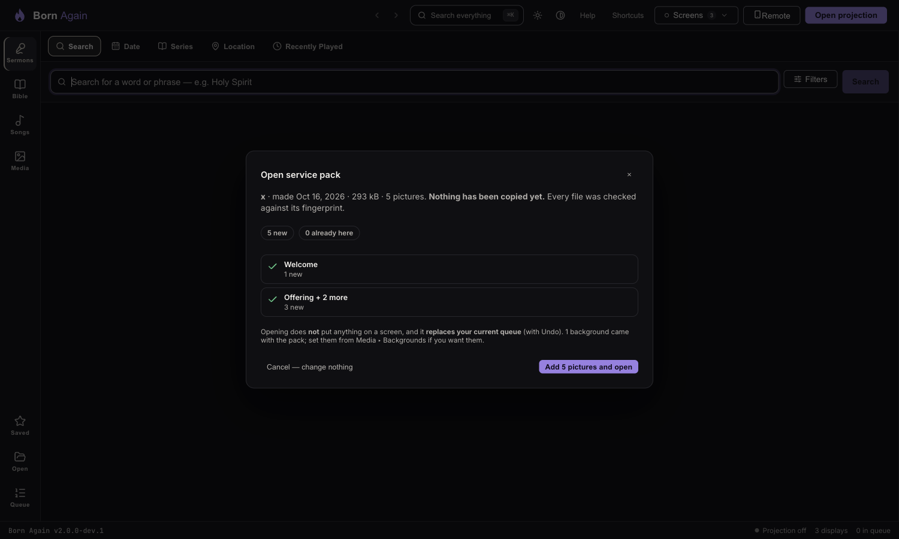

# Service packs: a service with its pictures in one file

A **service pack** (`.bornpack`) is your queue **plus every picture it uses** — pictures in the queue, every page of a slideshow, and the
backgrounds on your screens — in one file you can carry on a USB stick or send. Open it on another computer and the pictures come with it.
The ordinary **Save** (`.born`) is unchanged: it is smaller, and it is still the everyday way to save.

> A pack holds **pictures only** — no sermons, songs or settings. Anyone with the file can see the pictures, so share it like a photo album.

## Making one: Save + pictures

1. At the top of the queue press **Save + pictures**.

2. Look at the list and the size. Over **1 GB** BORN warns you (it may not fit a small USB stick); over **4 GB** or **5,000 pictures** it can't make one pack — remove some of the biggest.
3. Choose **Choose where to save…**. A progress bar shows each picture; **Cancel** stops it, and nothing is left behind.
4. BORN writes the pack under a temporary name and gives it its real name only when it is complete **and has been read back and checked**.

If a picture is **missing** (or on an unplugged drive), nothing is saved and BORN names it. Fix it with **Check**, then save again.

## Opening one: Open pack

Press **Open pack** (or drop a `.bornpack` onto the BORN window). BORN checks every file inside against its fingerprint **without copying anything**, then shows a review:

- **new** pictures will be copied in; **already here** ones are recognised by their contents (whatever they're called) and not copied again;
- **damaged** ones — the copy was cut short or changed — are named; the service still opens and those items show as missing, like any missing picture.

**Cancel — change nothing** really changes nothing. **Add N pictures and open** copies the new pictures and opens the queue. The copy is **all or nothing**: if you
cancel part-way, the disk fills, or anything goes wrong, every picture it added is removed again and your library and queue are exactly as before.
Opening **never puts anything on a screen** and **replaces your queue** (with **Undo**).

Backgrounds in the pack are **not** switched on for you (that would change what the congregation sees). The message at the end tells you they came along; set them from
**Media → Backgrounds**.

## If it won't open

BORN says what is wrong and that nothing was changed: *not a Born Again pack*, *cut short* (copy it again), *made by a newer Born Again*, *too big*, *not enough disk space*,
or *contains something that isn't a picture* (the whole pack is refused for safety; nothing is run). See [Troubleshooting pictures](../troubleshooting/media.md).

## Good to know

- You can open a pack with **any** computer running Born Again 2. Older versions (v1) don't know packs. A pack is an ordinary zip file: change `.bornpack` to `.zip`, take out `service.born`, and any version opens that (without the pictures).
- Phones can list and open saved services as before, but **can't make or open packs**.
