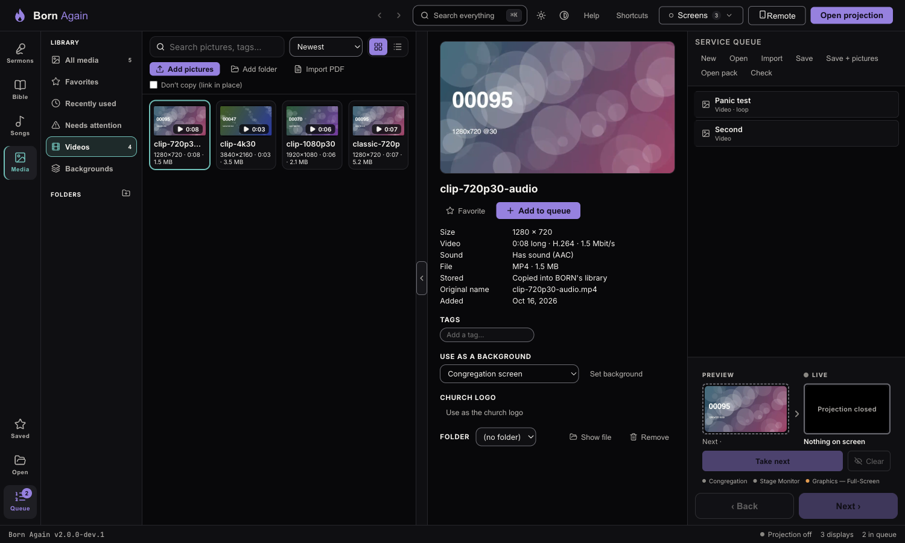
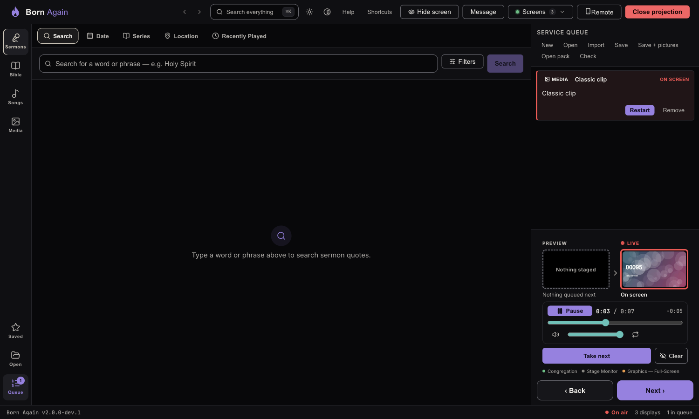
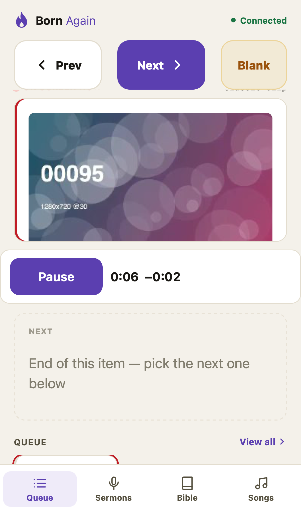
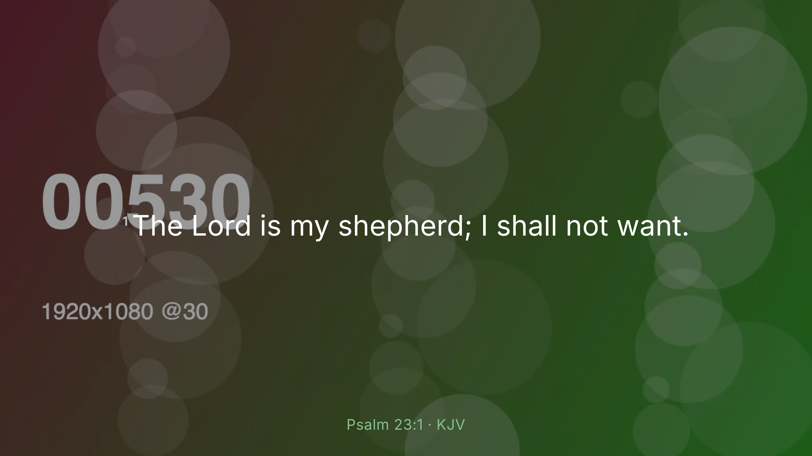

# Videos and moving backgrounds

Born Again can play **short video clips** (a testimony, a welcome, a countdown) and use a **looping video behind your text** (a moving background). It is built for
short clips and loops. A **long** video (a sermon recording, a concert) is better played from YouTube once that arrives — long local files are allowed but are not what
this is for.

## Adding a video

In **Media**, press **Add pictures** (it takes videos too) or drag a video onto the Media area. Videos appear under **Videos** on the left, with a ▶ and their length.

**What works:** **MP4** files with **H.264** video and **AAC** sound (or no sound), up to **4K (3840×2160)**. Almost every phone, camera and editor can make this.
Born Again reads the file itself and also plays **one real frame** on this computer before it accepts the video, so a video that is added is a video that plays.

**What is refused, with the fix on screen:** MOV, MKV, AVI and WebM files; HEVC (H.265), AV1, VP9 and ProRes video; sound formats other than AAC; and anything bigger than 4K.
The message says what is wrong and what to do — for example, *"In your editor, or in HandBrake, export it as MP4 with H.264 video and AAC audio (the ‘Web’ or ‘Most compatible’ preset),
then add that file."* A file that was **cut short** (an unfinished copy or download) is refused as *incomplete*.

**Warnings (never refusals):** 4K (it was only tested for 20 minutes — try it first on this computer), more than 30 frames per second, and very high bit rates
(over 20 Mbit/s up to 1080p, 40 Mbit/s for 4K). **Very large files** can be *linked in place* like pictures (tick **Don't copy**).

## Playing a video

1. Put the video in the queue (**Q**, double-click, or drag). In the queue row's menu you can choose **Loop the video**.
2. **Show** it. The video appears on the screen **paused on its first frame**. **Nothing plays by itself, and no sound starts when you Show.**
3. Press **Play** in the bar under the Live picture. You can **pause**, **drag the position**, change the **volume**, **mute**, and turn **loop** on or off.

The bar shows what the screen **really** reports. If the picture stops moving it says so in plain words; if the video ends it says *Finished* and offers *Play again*.
Taking a different item ends the video. A video that is **linked from a USB stick** that isn't plugged in can't be taken — Born Again tells you, and the screen does not change.

### The big key presses

- **Esc** (or **Hide screen**) stops the picture **and the sound at once**. When you show the screen again the video is back **paused** — it never carries on by itself.
- **Ctrl/⌘+Shift+L** (the church logo) replaces the video with your logo and ends it.
- **Alerts** (like a nursery call) still show on top of a playing video.

## Other screens

- **Stage monitor:** shows the **time left** in huge type and a progress bar — no picture.
- **Graphics (OBS/browser) output:** on a **Full-screen** output the video plays **without sound**, following the main screen's clock (it nudges its speed up to 5% and jumps only if it must).
  If it cannot keep in step (more than about half a second out, repeatedly) it shows the **still frame and the time remaining** instead of a picture that is out of step. A **Lower third**
  output never draws a video, so a video can never cover your camera. **Sound only ever comes from the main screen.**
- **Phone remote:** a **Pause / Play** button and the time appear under the live picture. The phone can **pause and resume the live video — nothing else** (no seeking, no volume), and **Play stays off until
  you have started that video once on the main computer**, so a phone can never be what first makes sound in the room.

## A moving background

In **Media → Backgrounds** (or a picture's pane → **Use as a background**), choose a **video** the same way you choose a still. It plays **muted and looping** behind your Bible verses, songs and quotes, with the
same **Dim** slider. It never makes sound and each screen loops it on its own. Pictures you show as content cover it.

## "Is tonight ready?" for videos

**Check** looks at each video: the file is there and **whole**, it is still an allowed format and size, and a frame **plays on this computer now**. It lists 4K, high bit rate and high frame-rate
warnings, an unplugged drive, and anything that won't play — with the fix. Play every video once in **Preview/Live** on the church computer before the service: a warning is a reason to do that.

## Limits to know

Born Again was tested on a modern Mac: 1080p video looped for 2 hours, 4K for 20 minutes, with no stalls. **An older church computer may be slower** — that is why 4K gets a warning and why you should
try the real files on the real computer. Videos can't go inside a **service pack** yet (pictures only); use a plain **File → Save** and carry the video file separately.
