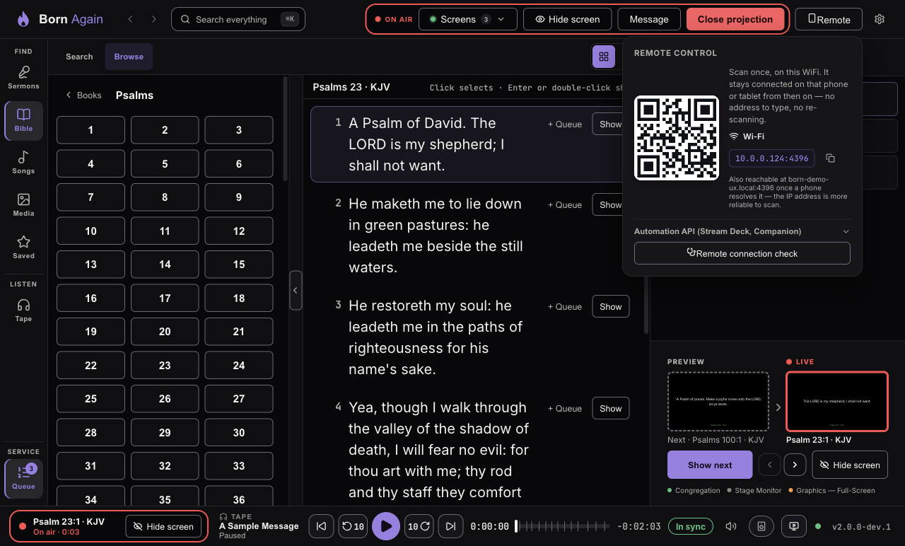
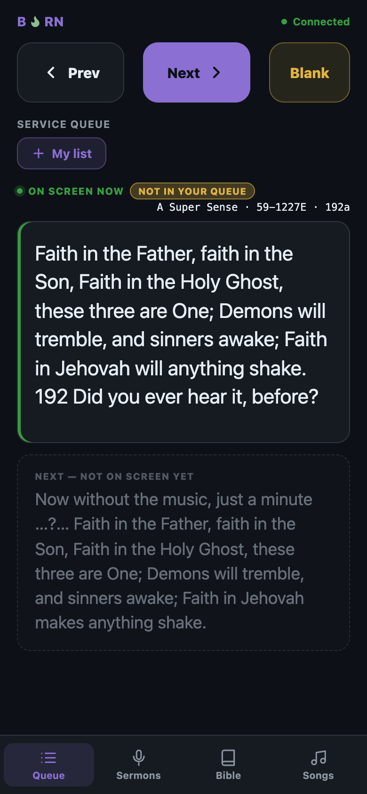
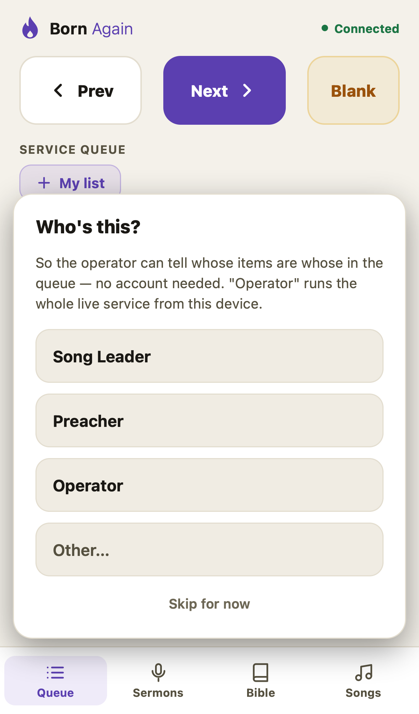

# The mobile remote

A phone or tablet, on the same WiFi as the Born Again computer, can search and advance
slides from anywhere in the building — handy for a second contributor, or for
walking the room while still controlling the queue.

## Connecting a phone, step by step

1. On the Born Again computer, click the **Remote** button (top of the window, phone
   icon). A popover opens showing a QR code.

   

2. On the phone, open its camera (or QR scanner) and point it at the QR code. It
   should offer to open a web page — tap it. (No app to install — this opens
   straight in the phone's browser.)
3. The first time, a card appears asking **"Who's this?"** — pick **Song Leader**,
   **Preacher**, **Operator**, or type your own name. This only labels whose items
   are whose if more than one phone is contributing; it's not a login and nothing
   is saved to an account. You can tap **Skip for now** instead.
4. You may also see a prompt to **"Add this to your Home Screen"** — doing so puts
   a Born Again icon on the phone for next time, so there's no QR code or typing needed
   again. **Skip for now** works fine too; you can always reopen it from the
   browser.

**How to know it worked:** the phone shows the same queue Born Again's main window does,
and the connection indicator (top of the phone screen) shows connected, not
"Connecting…".

## The tabs, and the hidden-screen banner

The bar at the bottom of the phone (the left side on a tablet) has six tabs: **Queue**,
**Sermons**, **Bible**, **Songs**, **Media** and **Tape**.

- **Media** lists the pictures and videos in the library with a thumbnail. **Show** puts one
  on the screens now (a video waits on its first frame, paused); **+ Queue** adds it to the
  queue and nothing goes live.
- **Tape** is the tape card: Play / Pause, ±10 seconds, previous / next paragraph, volume, and
  the paragraph list to jump to one. When no tape is loaded it says so — load one on the main
  computer first (Tape place).
- When the screens are hidden (Esc, or **Hide screen** on the phone) an amber **SCREEN HIDDEN**
  banner appears at the top. Tap it, or the **Show screen** button, to bring the screens back.
  The **Hide screen** button is 56 pixels or more high so it is easy to hit.

## If this computer is on more than one network

Some computers are on two networks at once — for example a network cable **and** the church WiFi. A phone can only reach Born Again through the network it is
actually on, so Born Again lists every network it found and lets you choose which one the QR code is for.

- Each row shows the network's name (for WiFi, the WiFi's own name), its address, and a copy button. The highlighted row is the one the QR code and address follow.
- **To switch**, click another row. The QR code changes straight away; scan it with a phone that is on *that* network.
- The line under the list says why Born Again picked the one it did — for example *"Showing Wi-Fi because phones usually connect over Wi-Fi."* It prefers a WiFi
  network, then a network cable. Once a phone has connected, Born Again remembers which network it came through and shows that one first next time.
- Networks phones can't use — VPNs, virtual adapters (Hyper-V, WSL, Docker, VirtualBox) and unconnected ports — are hidden. Click **Show all** to see them.

Born Again answers on **all** of this computer's networks at once, so a phone on any of them can connect; the selector only decides which address the QR code points at.
A computer with one network shows that network's name above its address, and no list.

### If a phone can't connect

Click **Remote connection check** at the bottom of the Remote popover. It shows
whether the remote is actually running, how many phones are currently connected,
which network address and adapter it's using, and a firewall hint for this
computer's operating system. A **Copy diagnostics** button there copies all of
that as text — handy to paste into a support request without having to describe
the setup by hand.

## Using it

The phone has its own transport bar (**Prev** / **Next** / **Hide screen**) always
visible at the top, and four tabs at the bottom: **Queue**, **Sermons**, **Bible**,
**Songs** — the same searches as the desktop app, sized for a phone screen.

Once connected on a given WiFi network, the phone stays connected on future visits
— no need to scan the QR code again unless it's a different network.

---

Next: [The Screens menu](screens-menu.md).

### Pictures

Picture and slideshow items show a small thumbnail in the queue and in the item's slide list, and the picture that is on screen
shows its thumbnail under **Now**. **Next / Prev** step a slideshow and **Hide screen** hides the screen. The phone has no seek or
sound controls.

The check tests **every** address of this computer and says which ones answer, shows whether any phone has connected and from which network, and gives a plain hint when a phone
is probably on the wrong network (*"Your phone must be on the same network as the address shown. If it cannot connect, try the other address."* — click the other network in the list and scan again).

**On Windows**, it also shows two PowerShell commands you can copy. Open PowerShell as Administrator and run the first, `Get-NetConnectionProfile`, to see whether each network is
**Private** or **Public**. The second, `New-NetFirewallRule …`, lets the remote through Windows Firewall on its port for Private networks. If your WiFi shows as **Public**, either
set it to Private in Windows settings, or change `-Profile Private` to `-Profile Any`. Born Again never changes firewall rules by itself.

"Answers" only proves the remote works *from this computer* — a firewall can still block a phone. If every address answers but a phone still can't connect, it is almost always the firewall or the wrong network.
