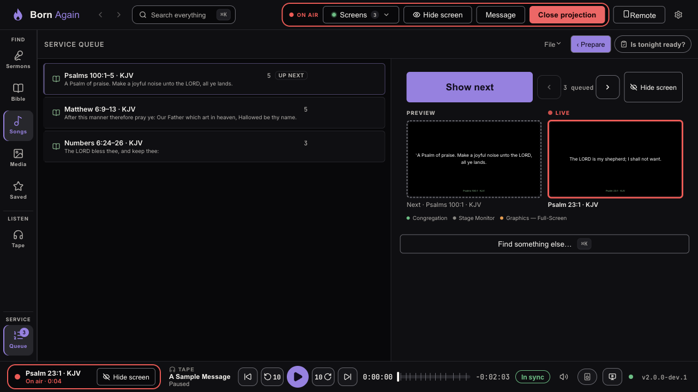

# Run view: the service, large

**Prepare** is the whole workspace: find things on the left, build the queue on the right. **Run** is for the service itself: the **queue** as a big list, and the **live controls** large beside it. Nothing about what is on the screens changes when you switch.

## Switching

- Press **Run view** at the top of the queue (it becomes **‹ Prepare** while you are in Run), or press **Ctrl+Shift+U** (**⌘+Shift+U** on a Mac) — the same keys switch back.
- On a brand-new install, Born Again switches to Run by itself when you **Open projection** and the queue has items. Everyone else keeps the way it was; turn it on or off in the **⚙** menu → **Switch to Run view when the screens open**.
- Press any section on the left rail (Sermons, Bible, Songs, Media, Tape) and you are back in Prepare, in that section. Your searches and place are exactly as you left them.
- **Find something else…** (or **Ctrl/⌘+K**) opens the search box; choosing a verse or song takes you to Prepare to show it.

## What is in Run

- **Show next** is the one big button. **Hide screen / Show screen** is beside it, and the small **‹ N queued ›** arrows step **Back** and **Next**. The keys are the same as ever: **→** or **Space** is Next, **←** or **Shift+Space** is Back, **Esc** hides the screens.
- **↑** and **↓** move between rows in the queue; **Enter** goes to that item, and **Show** on a row shows it.
- The two pictures show **Preview** (what Show next will bring up) and **Live** (what is on the screens now). The strip at the bottom of the window always says what is on air, in every section.
- On a small laptop window the list and the controls stay side by side; on a very narrow window (or a very large interface size) the list sits above the controls.
