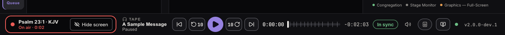
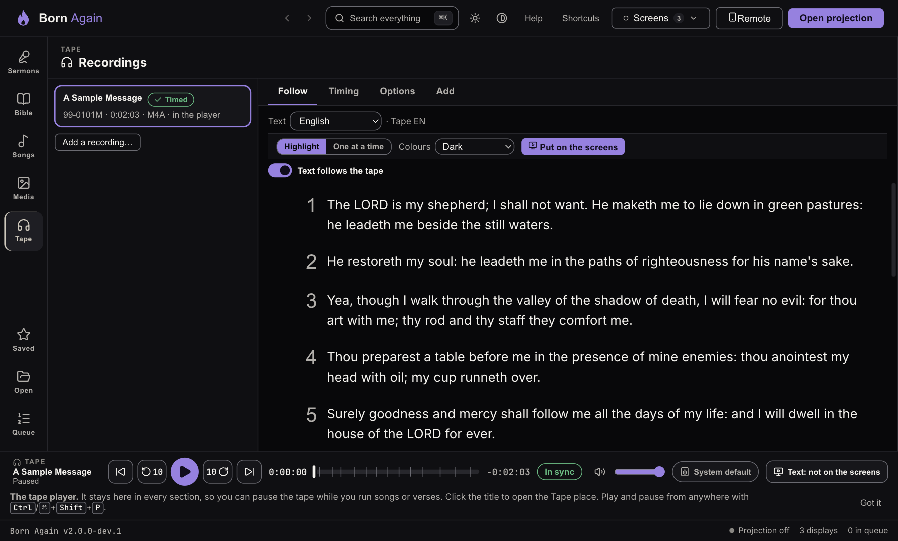
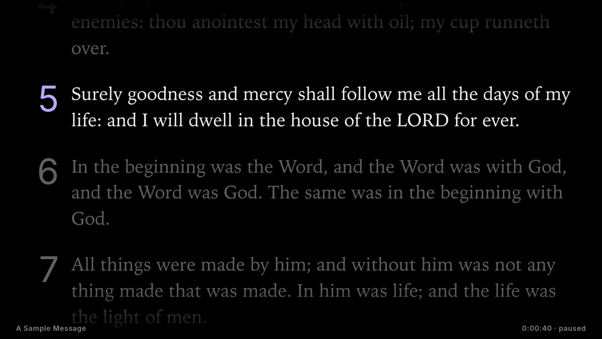
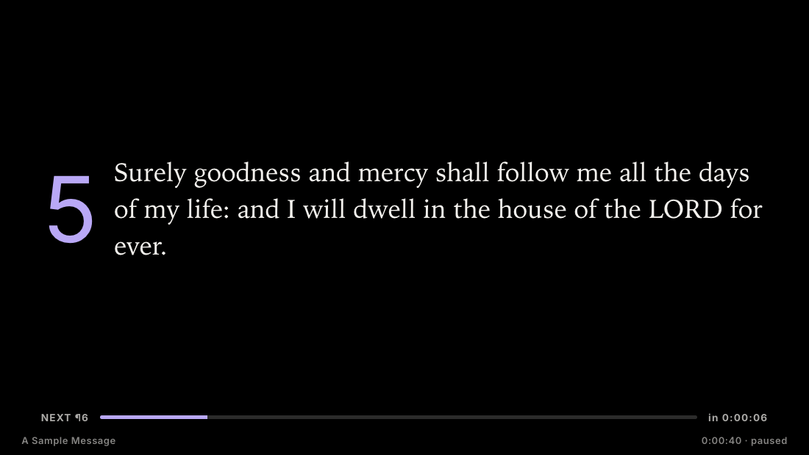
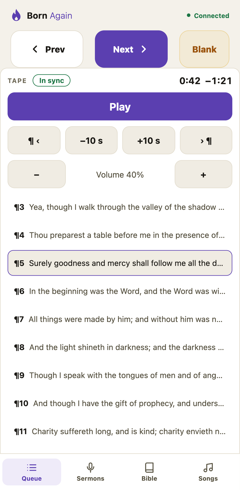
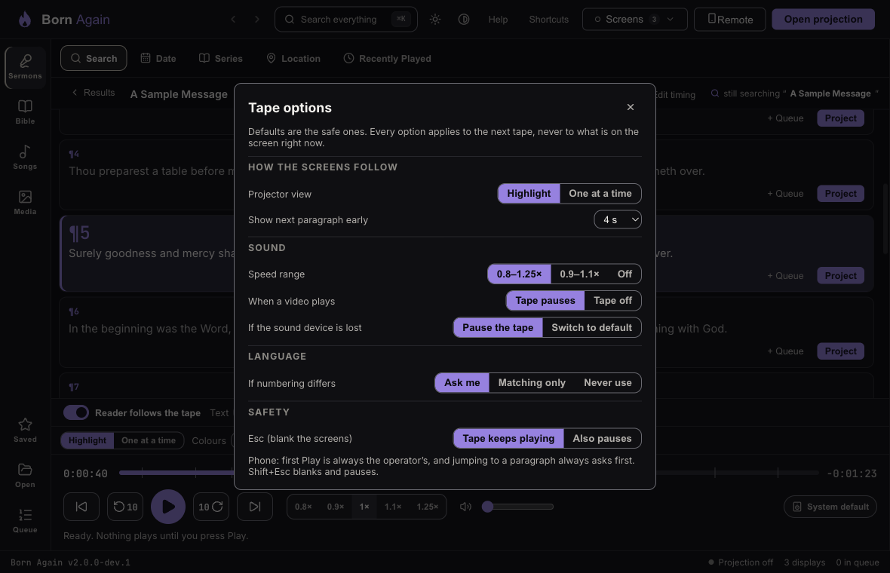

# Running a tape service

Some services play a **recorded sermon** — a message from the tape — while the congregation follows the text. Born Again plays the recording **and** keeps the text in step with it:
the paragraph being spoken is highlighted on your screen, on the congregation screen, on the stage monitor and on a Graphics (OBS) output.

Everything stays on this computer. Born Again **does not download or stream** recordings — you bring your own audio file (the **Get audio** button opens the publisher's page in your browser).

## Where things are

- **The player is the bar at the bottom of every section.** Once a tape is loaded it stays there whether you are in Sermons, Bible, Songs, Media, Queue or the Tape place, so you can pause it to run a song and carry on.
- **The Tape place** (the **Tape** button in the left rail) is where recordings live: the list of all your recordings and whether each is ready, the big follow-along text, timing, options, and adding a recording.
- **The Sermons reader is just a reader.** It has no player. When the open sermon is the one playing, a small chip says **Following the tape · ¶5** (click it to open the Tape place).

## Getting ready (once per recording)

1. Open the **Tape place** and choose **Add**. Say which sermon the recording is for (type a title or a date code), then **Add a recording for “…”…** — choose the file, drop it on the window, or let Born Again find it in your **Tape audio** folder.
   File names like `65-0418M It Is The Rising Of The Sun VGR.m4a` are matched to the sermon by their date code; if it is not certain, you are asked to confirm.
   (From the Sermons reader, **Add a recording** takes you here with that sermon already chosen.)
2. Born Again **checks the file** (it must be complete, with a length that fits the sermon) and keeps a **managed copy**, so a missing USB stick never breaks a service.
   **M4A/AAC** is best. A **variable-bit-rate MP3** can be a second off when you jump around (you are told when you add it). Very large **WAV** files are refused (convert them to M4A or FLAC).
3. **Time it once.** A recording only follows the text once it has *timing* — which paragraph starts when. In the **Timing** tab press **Tap to sync…**, play the recording, and press **Space** at the start of each
   paragraph (the reaction time is taken off for you). You can nudge a time, drag a marker, mark a stretch **No text here** (a song, a prayer) or **Tape differs here**, and **Undo**. Press **Save**.
   **Share timing** writes a small times-only file you can give to another computer — it holds **no text and no audio**.
4. *(Optional)* **Suggest timing** can propose the times for you, using speech recognition **you install yourself** (whisper.cpp — Born Again does not include it; choose its program and a model in
   the small tools panel). It runs on this computer, can be cancelled, and **only ever proposes**: it moves each start to where the speech really begins, then you review the least-sure paragraphs first
   (**Next least sure**) and press **Save**. Plan on minutes, not seconds, on an ordinary PC — run it before the service, not during it.

## During the service

- **Show** puts text on the screens. **Nothing plays and no sound starts when you Show.** Press **Play** in the bar when you want sound — Play is only ever in the bar and the Tape place, never next to Show.
- The bar has the recording and the paragraph being spoken, **Play/Pause**, **back / forward 10 s**, **previous / next paragraph**, the time and time left with a seek bar that has a mark at every paragraph start, **volume**,
  where the sound comes out, one word for how it is going (*In sync*, *Sound stopped*, *Output lost*, *Paused for video*…), and **Text: not on the screens / Text on the screens**.
- **Follow along.** In the Tape place the text follows the tape; scroll away to read ahead and a **Back to the tape** button brings you back. In the Sermons reader the same highlight shows on the sermon you have open.
- **Moving the tape.** Click a paragraph's **number** (in the Tape place or the Sermons reader) to move the tape there — an **Undo** appears. Clicking the text of a paragraph never moves the tape. You can also click the seek bar, or use ±10 s and the paragraph buttons.
- **Show the text on the screens** with the bar's **Text: not on the screens** button, or in the Tape place:
  - **Highlight** — a screenful of the sermon; the paragraph being spoken is bright with a large number, the rest is dimmed, and the text glides along.
  - **One at a time** — one paragraph fills the screen. **Next early** (0–10 s) switches a little before the speaker starts the next paragraph; a slim bar and **NEXT ¶** show what is coming.
  - Long paragraphs are shown a page at a time, moving with the tape.
  Pick **Dark / Light / High contrast** colours. A change while the screens are up waits for **Apply to the screens**. **Screens follow the tape** off holds the paragraph that is up while the tape moves on.

- **Stage monitor** shows the time and time left, a bar, **NOW ¶** and **NEXT ¶ in 0:45**, and one plain word (*Playing*, *Paused*, *Sound has stopped moving*…).
- **Graphics / OBS** shows the tape as **lower-third pages** (about two lines each), turning at the tape's pace.

### Moving around while the tape plays

- Go to **Songs, Bible or Media** — the tape keeps playing and the bar stays. Show a **verse** or an **announcement** on the screens and the tape keeps playing; its text is off the screens, and a note offers **Back to the tape text**.
- A **video or YouTube** item **pauses the tape** and the bar says **Paused for video**, with a **Resume the tape** button. Only one thing makes sound at a time.
- **Alerts** (like a nursery call) show on top of the tape as usual.

### Keys and Esc

- **⌘/Ctrl+Shift+P** play/pause, **⌘/Ctrl+Shift+←/→** back/forward 10 s, **⌘/Ctrl+Shift+[ / ]** previous/next paragraph — from any section; never while you are typing or inside the timing editor. (Plain Space and the arrows keep meaning *next slide*.)
  The same actions are in the command palette (**⌘/Ctrl+K**, type "tape").
- **Esc** blanks the screens and **the tape keeps playing**. **Shift+Esc** blanks **and pauses** the tape. (**Tape options** can make plain Esc pause too.)

### If something goes wrong

- **The sound output is unplugged:** the tape pauses; the bar says **Output lost** with **Choose the output…**. Choose it again, press Play.
- **The sound stops moving or the player stops answering:** the bar says **Sound stopped** with **Restart the sound**.
- **Sleep:** the tape pauses when the computer sleeps and stays paused.
- **The recording file is missing:** the library says so, and *Is tonight ready?* tells you before the service.

## Another language

The **text** language and the **recording** language are chosen separately (the **Text** menu in the Tape place; the recording keeps its own language). A timing belongs to the recording and is keyed by **paragraph number**, so the same English recording can drive a Spanish text — **if the paragraphs are
numbered the same way**. If they are not, Born Again says where ("…205 numbers match. Only in the timing: 206–207…") and lets you **use matching numbers only**, **not follow this text**, or **line up the differences**
("this text's ¶113 is the timing's ¶115"). Text in Arabic, Persian, Urdu, Amharic, Thai and other scripts is drawn with the right direction; if this computer has no font for a script, you are told **before** you take it.

## From the phone

The phone remote shows a **Tape** card: **Play/Pause**, **−10 s / +10 s**, **previous / next paragraph**, **volume** (a little either side of the level you set), the time, a **sync** word, and a list of paragraphs that **follows the tape**.
The rules are the video rules: **Play stays off until you have started the tape once on the computer**; there is **no seek bar**; **jumping to a paragraph asks first**, and an **Undo** appears on the computer.

## Is tonight ready?

*Is tonight ready?* (**Check** in the Service Queue) checks every sermon in the queue that has a recording: the file is there, its length fits, it has timing, and the chosen sound output is plugged in.

## Tape options

The **Options** tab of the Tape place holds the choices: projector view, next-paragraph lead, speed range, what a video does to the tape, what to do if the sound device is lost, what a language mismatch does, and what Esc does.
Defaults are the safe ones, and every option applies to the **next** tape, never to what is on the screen now.

*A first-time hint appears once on the bar and once in the Tape place; **Got it** hides it for good.*
