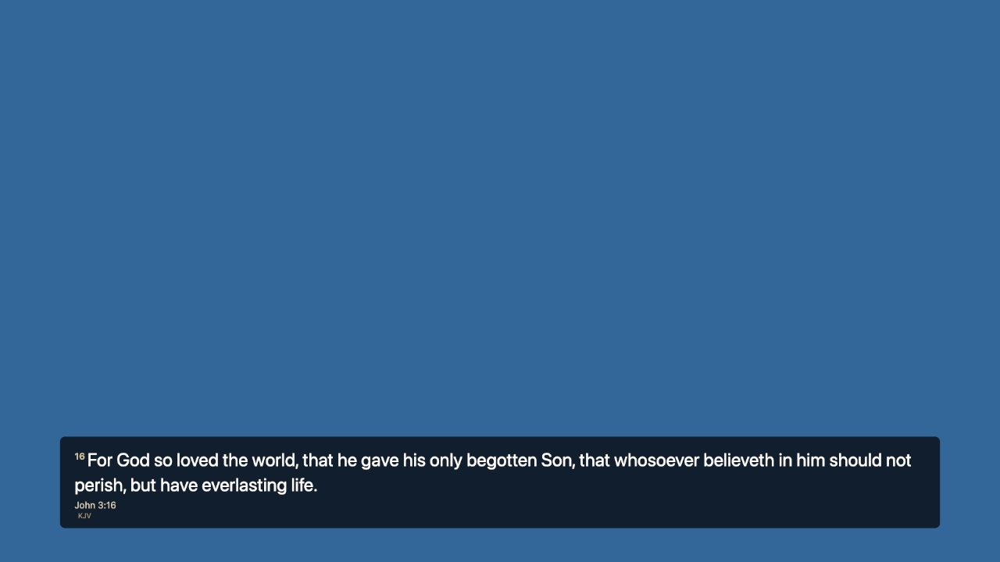
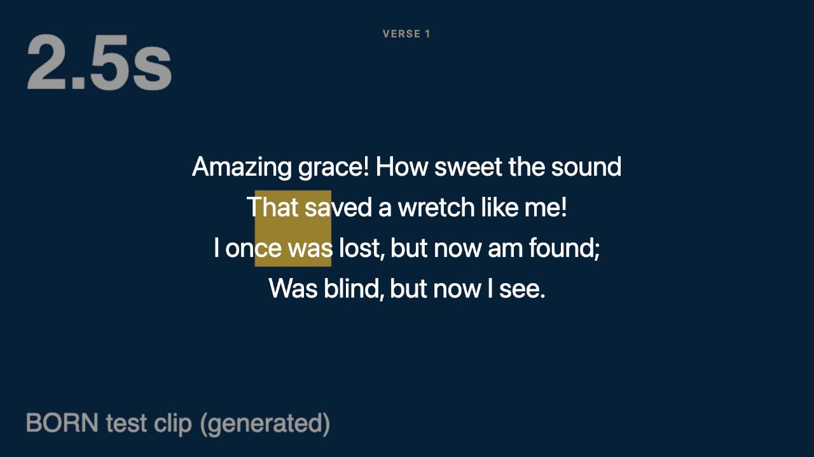
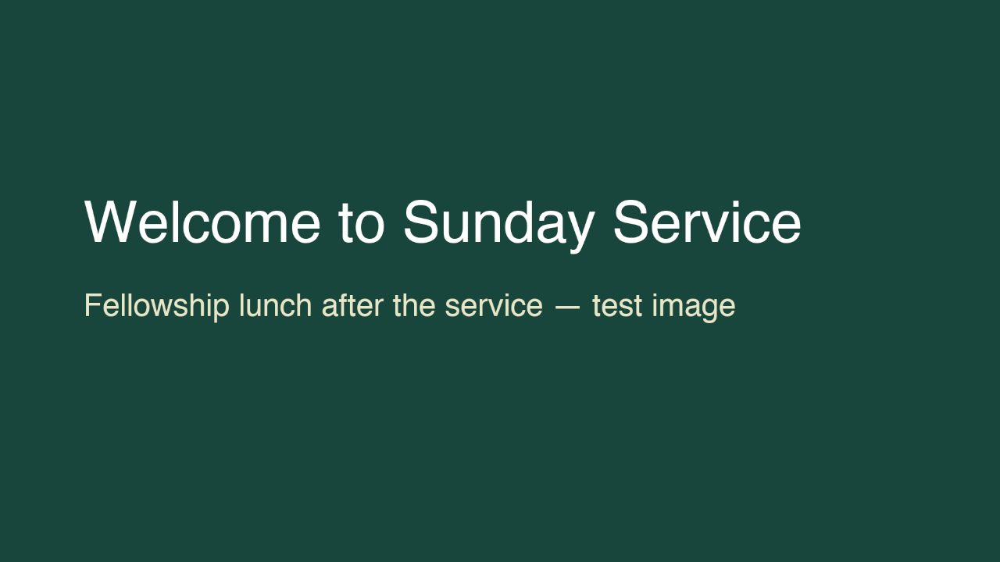
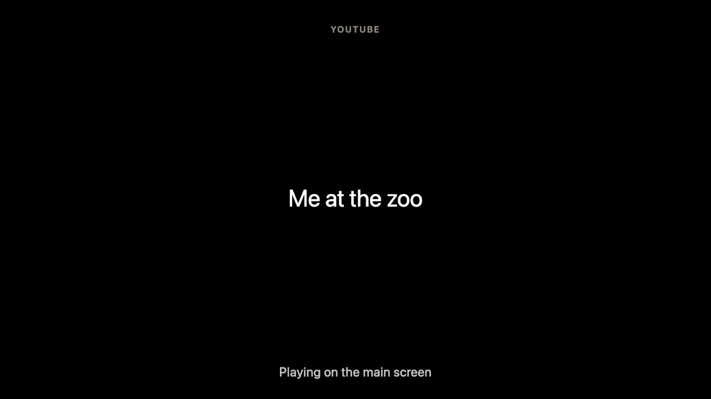

# Using BORN with OBS (livestream and recording)

This page is for the media team. It sets up **OBS Studio** so that what BORN shows is also on the livestream: scripture and lyrics over the camera, full-screen
lyrics, announcement pictures, and a "Starting soon" screen. It was tested live with OBS 32 on a Mac. Windows steps are marked — they were written from the same
design but **not yet tried on a Windows computer**.

## What you need

- **OBS Studio 30 or newer** (free, obsproject.com) on the same computer as BORN, or on another computer on the same network.
- BORN open, with **one Graphics output** on the Main channel (Screens → Manage… → Outputs → **Add Graphics**).
- The file **BORN-scenes.json** (a ready-made set of OBS scenes). It is in BORN's `docs/manual/obs` folder.

## One-time setup (about 10 minutes)

1. **In BORN:** Screens → Manage… → Outputs. Find the Graphics row. Under it BORN shows two addresses. **If OBS is on the same computer as BORN, copy the one that says
   "OBS on this computer"** (it starts with `http://127.0.0.1`). If OBS is on another computer, use the first address (see "OBS on another computer" below).
2. **In OBS:** *Scene Collection → Import* and choose **BORN-scenes.json**, then *Scene Collection → BORN*. You now have seven scenes.
3. Still in OBS, right-click the source **BORN Lower Third** → **Properties**. In **URL**, replace the part up to `?profile=` with the address you copied, and **keep** the
   `?profile=lower-third` ending. Press OK.
4. Do the same for **BORN Full-screen** — keep its `?profile=fullscreen` ending.
5. **Settings → Video:** Base and Output resolution **1920×1080**, **30 FPS**. (1280×720, 4K and 60 FPS also work; in the scenes, make each BORN source stretch to the
   whole picture — right-click the source → Transform → **Stretch to screen**. The imported scenes already do.)
6. **Test:** in BORN, project a Bible verse. In OBS choose the scene **1 Camera + Lower Third**. The verse should appear at the bottom within a second. Press **Clear** in BORN
   — it disappears.

## Why there are two BORN sources

One BORN output can feed **two different layouts at once**. The address ends with:

- `?profile=lower-third` — a transparent picture with a text band at the bottom. Put it **over the camera**.
- `?profile=fullscreen` — a solid full-screen layout. Use it in scenes that **replace** the camera (lyrics, announcements, video).

(Without any ending, the page uses whatever the output's profile is set to in BORN. The `?profile=` ending always wins for that source.)

## The scenes, and when to use each

| Scene | What it shows | Use it when |
|---|---|---|
| **1 Camera + Lower Third** | Camera with BORN's lower-third band over it | Preaching and scripture readings. This is the main scene. |
| **2 Lyrics Full-screen** | Full-screen lyrics (with a moving background if you set one in BORN) | Congregational singing, when the stream should show the words big |
| **3 Announcements + Pictures** | Full-screen pictures | Announcements, a welcome picture, a slideshow |
| **4 Video clip** | The video clip from BORN, silent (see Sound) | A short testimony or welcome clip |
| **5 YouTube** | Camera with the lower third. **BORN never puts a YouTube video into a Graphics output** (see below) | A YouTube video is playing in the room |
| **6 Starting Soon** | "Starting soon" on a dark background | Before the service starts and after it ends |
| **Blank** | Nothing | Emergencies |

The "Camera placeholder" in the scenes is just a flat colour. **Replace it** (right-click → *Properties*, or delete it and add your own *Video Capture Device*). Keep it
**below** the BORN source.

## The OBS source settings that matter

These are already set in BORN-scenes.json. They were each tested, so please leave them:

- **Size 1920×1080** (match your OBS picture) and the source **stretched to the screen**.
- **Shutdown source when not visible: OFF.** Switching to a scene shows the words in about **0.02–0.05 seconds**. With it ON, the page reloads each time and the words took
  **0.6–0.9 seconds** to appear.
- **Refresh browser when scene becomes active: OFF.** It is not needed: BORN keeps the page up to date, and reconnects by itself (see below).
- **Control audio via OBS: OFF** and no custom CSS. BORN's page is already transparent where it should be.
- You can leave the browser source's frame rate at 30.

## OBS on another computer

Use the first address BORN shows (it contains the computer's name or its network address). Two things matter:

- A name ending in **.local** works on a Mac and often on Windows (Windows needs Apple's *Bonjour*, which comes with iTunes or iCloud for Windows). **If BORN is restarted,
  OBS can take over a minute to find a `.local` name again.** The address made of numbers (for example `http://192.168.1.23:4316/…`) reconnects in a few seconds. If you
  can, give the BORN computer a fixed address in your router and use the numbers.
- Use a **cable** for both computers if you can; Wi-Fi is the most common cause of a late or missing overlay.

## Sound

**BORN's video page in OBS is always silent on purpose** (the sound plays from the BORN computer, from the congregation screen's output). To get a video's sound into
the stream, add **one** of these to the scene (all need permission the first time):

- **Mac:** *Add source → macOS Audio Capture (application audio)* and choose BORN ("Branham or Nothing"). This needs macOS 13 or newer, and macOS asks you to allow **Screen
  & System Audio Recording** for OBS once. If you prefer, install a free loopback device (such as BlackHole) and send BORN's sound to it.
- **Windows:** *Add source → Application Audio Capture* and choose BORN's window; or *Desktop Audio* if nothing else makes sound on that computer. *(Not yet tried on Windows.)*

Test it once with a short clip and watch the OBS audio meter move. Do not use the browser source for sound.

## YouTube during a livestream

BORN plays a YouTube video **only in the room**, inside YouTube's own player. It is **never** sent to OBS: a Graphics page would have to run a second YouTube player with its
own internet, its own ads and its own clock. So in OBS the Graphics output shows only the **name** of the video (full-screen layout) or **nothing** (lower third).

If the stream should show the video too, the supported way is to **capture BORN's output window in OBS**: *Add source → Window Capture* (Windows) or *macOS Screen Capture
→ Window* (Mac) and choose the BORN output window. The Mac asks for **Screen Recording** permission for OBS once. (This part could not be tested without that permission
prompt; try it before the service.) YouTube's ads and any rights questions are the same on the stream as in the room — see **Using YouTube**.

## Alerts and the panic key

- **Alerts** (nursery calls and so on) are for the **room** and the **stage monitor**. They are never drawn on the stream.
- **Clear / Esc / the phone's Blank** clear the room **and** the stream output at the same time. A lower third fades out in about a third of a second.
- If BORN stops while a verse is on the stream, the words stay for about **10 seconds**, then clear by themselves.

## If BORN or the network drops

- **BORN restarted** (or crashed): with the same-computer address the overlay is back about **3–5 seconds** after BORN is running again. With a `.local` name it can be 70
  seconds or more (see above). You do not need to refresh OBS.
- **The connection dies silently** (a Wi-Fi change, a laptop waking up): the page notices after **45 seconds** of silence and reconnects by itself. BORN sends a signal every 15 seconds.
- You will not see a red "RECONNECTING" message in OBS; that message is only for people looking at the page in a normal browser.

## Sunday-morning checklist (5 minutes before the service)

1. BORN is open, **Graphics output** is listed under Screens → Manage… → Outputs, and the queue is loaded.
2. OBS has the **BORN** scene collection selected, **1920×1080, 30 FPS**.
3. In BORN, project a verse and check **scene 1** shows it; press **Clear**.
4. Check one song in **scene 2**, one picture in **scene 3**.
5. If you play video: play a short clip and check **scene 4** moves and the **audio meter** moves.
6. If you play YouTube: use **Test play** in BORN and read **Is tonight ready?** once, on the internet connection you will use.
7. Press **Esc** in BORN once to be sure the stream output clears, then show again.

## If the overlay is blank — fix it in this order

1. In BORN, look at the Graphics output row: does it say the remote is unavailable? Another program may be using BORN's port (4316 unless changed). Close it and restart BORN.
2. In OBS, is the scene that contains the BORN source **the one on air**? A browser source only draws while its scene is showing.
3. Right-click the BORN source → **Properties** → **Refresh cache of current page**. (Always do this after updating BORN.)
4. Check the **URL** is exactly what BORN shows, still ending in `?profile=lower-third` or `?profile=fullscreen`, and the **Width/Height** match your picture.
5. Open that same address in an ordinary web browser on the OBS computer. If it does not load there, the problem is the network address, not OBS: use the same-computer address, or the numbers instead of the `.local` name.
6. Last: restart OBS, then BORN. Nothing is lost; the page reconnects.

## What was tested, and what was not

Tested live (Mac, OBS 32, BORN dev build): everything above, including 720p/1080p/4K, 30 and 60 FPS, 4:3 and vertical pictures, right-to-left and non-English text, very long
verses, restarts, a silent connection death, and a dropped-frame check (none over six minutes). **Not tested:** Windows, a real livestream platform, sleep/wake, hardware-acceleration
on/off, the Esc and Ctrl/Cmd+Shift+L keys pressed on a real keyboard, application-audio capture and window capture (each needs a macOS permission). Please try these on the church computer.

---

Next: [Presentation profiles](profiles.md).
