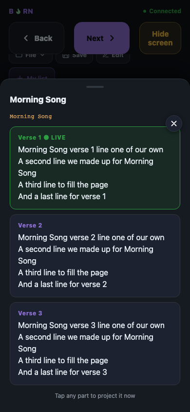
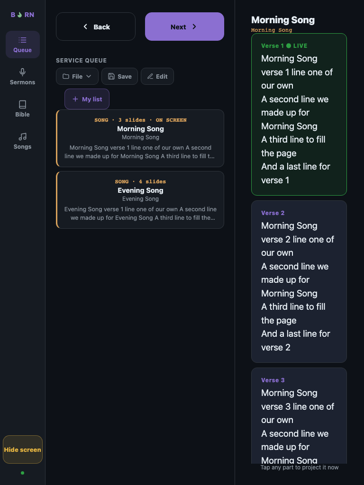

# v1-mobile-review: the phone remote, end to end

Review only. Nothing that ships was changed. Branch `v1-mobile-review`, cut from `main` at 1.13.11.

## Verdict

**The reported bug is real and was reproduced every time.** When a song is started from its **queue row** (tap the song in the queue, then
tap a verse), the song goes on the screen but the phone stays on that song's full page. On a phone the page covers **Back**, **Next** and
**Hide screen**. On a tablet-width screen the full song stays in the right pane, and nothing on the Queue tab brings the live view back.
The cause: that one way of projecting sends the tap and then does nothing else. Every other way (Project from Songs, Bible or Sermons)
closes the page and moves to the live view. Confidence: **high**. It failed in 12 of 12 runs (both browser engines, phone and tablet width,
all three roles) and under every service condition tried.

There is a second, rarer way to the same picture: on a slow network a tap that worked is reported as *"Couldn't reach BORN"* (MR-02), and
the phone then stays on the song's page from Songs too.

**Overall health:** the phone stays in step with the computer well (live state, two phones, sleep, Wi-Fi loss and a restart of BORN all held
up), but several pages hide the live controls or go stale, and a few messages say the wrong thing: 19 findings, 3 of which can hurt a live
service.

## The reported bug in detail (MR-01)

### How the phone page works

| Question | Answer | Where |
|---|---|---|
| How does the phone get its state? | It asks the computer for `/state` once a second, and at once when the page becomes visible again. No push. | `src/main/remoteAssets.ts` 1087, 1093–1095, 1114–1138; `src/main/webRemote.ts` 314–322 |
| What decides which screen shows? | Three things held by the page: the tab (`state.tab`), whether a full page is open over it (`#sheetOverlay`), and on a wide screen which item fills the right pane (`state.detailIndex`, `state.selected`). | `remoteAssets.ts` 768–775, 1041–1050, 1542–1572 |
| How is "project" sent? | A `POST /command`. The computer answers 204 as soon as it has passed the command to the operator window, before anything is on screen. | `remoteAssets.ts` 951–976; `webRemote.ts` 444–473; `src/main/index.ts` 2331–2400 |
| What does the phone do with the answer? | Depends on where the tap was made, see below. | |

### What happens, step by step

Steps (any role, phone 390x844): Queue tab, tap the card of a queued song, tap a verse on the page that opens.

| Step | On the phone | The phone's own state | The computer reports |
|---|---|---|---|
| Before | Queue tab, live view | no page open | nothing live, or another item |
| Tap the song's card | The song's full page opens over 92 % of the screen | `detailIndex` set, page open | unchanged |
| Tap a verse | **The full page stays.** The verse gets a green **LIVE** mark within a second. Back, Next and Hide screen are under the page. | `detailIndex` still set, page open; live row and page are correct | the song is live at that verse |
| Close the page (X, or tap above it) | Queue tab with the correct live view | page closed | same |

On a tablet-width screen (768 px and wider, which includes most phones turned sideways) there is no page to close: the full song fills the
right pane, tapping **Queue** again changes nothing (6 of 6 runs), and only opening another tab and coming back shows the live view. That
matches the owner's words exactly: *"it stays there until you tap somewhere else and then go back to the queue"*.

### Results

`scripts/repro-project-song.cjs`, real taps in Chromium and WebKit against the real app (`evidence/repro-project-song.json`):

| Way in | Phone width | Tablet width |
|---|---|---|
| Songs search, then **Project** | live view, all roles, both engines | live view |
| Songs search, then tap a verse | live view | live view |
| **Recently played**, then **Project** | live view | live view |
| **Queue row, then tap a verse** | **stays on the full song: 6 of 6** | **stays on the full song: 6 of 6** |

`scripts/repro-conditions.cjs` repeated the two main ways in under service conditions (`evidence/repro-conditions.json`):

| Condition | From Songs (Project) | From the queue row |
|---|---|---|
| Nothing live / the same song live / another song live / a Bible verse live | live view | stays |
| A 30-verse song / a song whose key was just changed | live view | stays |
| A second phone connected (it shows the right page each time) | live view | stays |
| Every answer 1.5 s slow | live view | stays |
| The answer to the tap comes after 5.5 s | **stays, and says "Couldn't reach BORN"** (MR-02) | stays, same message |
| Network off at the tap | nothing goes live, the phone says so | nothing goes live, the phone says so |
| Page asleep while the service moved on, then woken (Chromium only) | live view | stays |

### Root cause

- The verse rows of a queue item's full page send the command and nothing else: `onclick="cmd('project-at', …)"`, with no step after it
  (`remoteAssets.ts` 1592; the same for its **Project** button at 1585).
- The pages opened from Songs, Bible and a sermon search do have that step: they close the page and switch to the Queue tab once the screen
  has changed (`afterProjectFromSheet`, 2514–2522, and `sheetAction`, 2724–2736).
- The page opened from the queue is drawn over everything, including the bar with Back, Next and Hide screen (`.sheet-overlay`,
  `position:fixed; inset:0; z-index:70`, CSS line 386; 92 % high at line 394).
- On a wide screen the right pane shows the full item for as long as `state.detailIndex` is set (1550–1553). Only three things clear it:
  opening another tab (`setTab`, 1044, which skips this when the tab is Queue), opening an item from Songs, Bible or Sermons (2681), and the
  item being removed (1603–1616). Tapping **Queue** itself does not.

**Why leaving and coming back "fixes" it:** nothing was wrong underneath. The Queue tab kept receiving the live state every second and was
drawn correctly all along (1132); it was only covered (phone) or replaced in the right pane (wide screen) by a page that is never told to
step aside. Leaving removes that page. It is not a stale state, a lost event, an old cached page or a race: the phone's own state matched
the computer in every run.

**How sure:** high. What would settle the last doubt is the owner confirming two things: the song was started by tapping it in the queue
(not Songs, then Project), and whether the phone was upright or on its side.

### What the correct behavior should be

The Help page says: *"Back, Next, and Hide screen sit at the top of every tab, so you never have to switch tabs just to advance a slide."*
Every other way of projecting from the phone ends on the live view. Two reasonable behaviors:

| | Behavior | For | Against |
|---|---|---|---|
| A | After the tap, close the full page and show the live view, as Songs, Bible and Sermons do. | One rule everywhere; matches the Help and the owner's "proper behavior". | Jumping between verses of the live song takes one more tap each time (tap the live card to reopen the song). |
| B | Keep the full page open as a "whole song" view, but never over Back, Next and Hide screen, and with a clear way back to the live view on wide screens. | Fast verse-to-verse jumps for a song leader. | Two different results for "project", and the phone still does not show what comes next. |

**Recommended: A**, plus the part of B that keeps Back, Next and Hide screen reachable over any open page (MR-08).

## Findings

Severity: **hurts** = hurts a live service, **noticeable**, **cosmetic**. Line numbers are `src/main/remoteAssets.ts` unless another file
is named. Evidence files are in `docs/qa/v1-mobile-review/evidence/`.

| Id | Flow | What is wrong | Steps | Evidence (phone against computer) | Severity | Proposed fix |
|---|---|---|---|---|---|---|
| MR-01 | Projecting from the queue | The reported bug: after a verse is tapped on a queue item's full page, the phone stays on that page. Phone: Back, Next and Hide screen are covered. Wide screen: the right pane never returns to the live view. | Queue, tap a song's card, tap a verse. | Phone: full page open, Next covered. Computer: the song is live. 12 of 12; `repro-project-song.json`, `stuck-phone-queue-row.png`, `stuck-tablet-queue-row.png`. | hurts | After a project from this page, do what `afterProjectFromSheet` does: close the page, clear `detailIndex`, show the live view. Lines 1585, 1592, 1617–1630, 1044, 1550. |
| MR-02 | Any tap on a slow network | A tap the computer acted on is reported as failed when its answer takes more than 4 s. The phone says *"Couldn't reach BORN — check the connection and try again"*. Trying again sends it twice: a second **Next** skips a page. The Help says that message means the tap did not go through. | Hold the answer to `/command` for 5.5 s, tap Next. | Phone: "Couldn't reach BORN". Computer: moved from verse 12 to 13. Same for Project: the song is live, the phone stays on the song's page. `resilience-*.json` ("late"), `repro-conditions.json` ("late-answer"). | hurts | When a tap times out, say "No answer yet", read `/state` and report what really happened. Give each tap an id so the computer can ignore a repeat. `cmd` 951–976; `webRemote.ts` 444–473; Help `mobile-remote.md` ("If the connection drops"). |
| MR-03 | Projecting a sermon paragraph | On a sermon's full page (Sermons, Series or Date, a sermon), tapping a paragraph puts it on screen but the phone gives no sign: the page stays, covers Back, Next and Hide screen, marks nothing as live and shows no message. | Sermons, Series, a series, a sermon, tap a paragraph. | Phone: Sermons tab, full page open, 0 rows marked LIVE. Computer: the screen changed. `flows-*.json` ("project"). | hurts | Same step as MR-01 after `cmd('project-sermon')` in `projectSermonParagraph`, 2032–2038. |
| MR-04 | Every command | The computer answers "OK" (204) to every command, also when it could not act. The phone then says it worked. | (a) Open a saved service whose file is gone. (b) Project a row another phone removed. | (a) Phone: *"Loaded 'Review service'"*; computer: queue still empty. (b) answered 204. `flows-*.json` ("file", "roles"). | noticeable | Let the command handler report "could not" and answer 404/409 with a short reason; `cmd` already shows a refusal. `webRemote.ts` 458–472; `src/main/index.ts` 2331–2400; `src/renderer/src/App.tsx` 816–900. |
| MR-05 | Wi-Fi drop, BORN closed | While the phone cannot reach the computer, the live card still reads **ON SCREEN** with the last page it knew, at full strength. Only the small label at the top says "Reconnecting…". | Go live, turn the network off (or close BORN), look at the Queue tab. | Phone: "ON SCREEN The Long Road Song". Computer: unreachable (and, after a restart, nothing on screen). `resilience-*.json` ("wifi", "closed"). | noticeable | When `setConn(false)` runs, dim the live card and the live bars and label them "Last known". 1161–1166, 1200–1217, 1318–1345. |
| MR-06 | Live view of a song from Songs | A song projected with Project from Songs is live but is not a queue row, so the live card cannot be opened: there is no way to jump to another verse except finding the song again in Songs. | Songs, a song, Project; on the Queue tab tap the live card. | Phone: "ON SCREEN · NOT IN YOUR QUEUE", the card does nothing. Computer: live row none. `flows-*.json` ("project"). | noticeable | Send the live item's pages in `/state` when it is not a queue row, and let the live card open them. 1325, 1336; `webRemote.ts` 64–74; `index.ts` 1581. |
| MR-07 | Queue, "View all" | The **Full Queue** list is drawn once and never updated while open. It goes on marking the old item as ON SCREEN. From the code: its rows are bound to positions, so after another phone adds or removes an item a tap can open a different item. | Phone B: View all. Phone A: project another item. | Phone B's list: Morning Song ON SCREEN. Computer: Evening Song live. `flows-*.json` ("queue"). | noticeable | Redraw the list on each poll like the item page (`refreshOpenDetailSheet`), and open rows by id. 1448–1450, 1405–1424, 1180–1192. |
| MR-08 | Rotation | A phone turned on its side (844 px wide) switches to the wide layout while the full page stays open over it: the item shows twice and Next is covered. | Open a queue item's page upright, turn the phone. | Layout wide, page still open 359 of 390 px high, Next covered. `resilience-*.json` ("rotate"). | noticeable | Keep the bar with Back, Next and Hide screen above any open page, and close or re-place an open page when the layout changes. CSS 386–394; 2664–2669. |
| MR-09 | Phone back button | Opening a page adds no history entry, so the phone's back button or back swipe leaves BORN's page instead of closing the open page. | Open a song's page, press back. | History entries 2 before and 2 after opening; back went to a blank page. `resilience-*.json` ("back"). | noticeable | Push a history entry when a page opens and close the page on `popstate`. 2680–2699. |
| MR-10 | + Queue | A fast double tap on **+ Queue** adds the item twice (WebKit run; once in the Chromium run, so it depends on timing). | Songs, a song, double tap + Queue. | Computer: "Evening Song" in the queue 2 times. `flows-webkit.json` ("queue"). | noticeable | Disable the page's buttons from the tap until the answer. `sheetAction` 2700–2737. |
| MR-11 | Change key | A key set from the phone changes the song in the library only. The same song already in the queue (or live) keeps its old key line until it is queued again. | Queue River Song, open it in Songs, Change key, D. | Song page: "Key of D". Queue row: "River Song". Queued again: "River Song · Key of D". `flows-*.json` ("songs"). | noticeable | When a key changes, update the key line of queued copies of that song. `App.tsx` 598–612; `index.ts` 2093–2105. |
| MR-12 | New service | New service empties the queue and hides the screen, but the last page of the old service stays loaded. One tap on **Show screen** puts it back in front of the congregation. | File, New service, then Show screen. | Phone before: "Nothing on screen yet", button "Show screen". After one tap, computer: "Morning Song verse 1" on screen. `flows-*.json` ("file"). | noticeable | Clear the loaded page when a new service starts, so there is nothing to show again. `App.tsx` 1428–1442 (and the operator's own New service at 1112). |
| MR-13 | Touch targets | Controls under 44 px: Close (X) on every page 34x34 (the only visible way out of a full page); Move up, Move down and Remove 34x34; File, Save, Edit 36 high; the Bible back arrow 30x20; the verse jump chips 31 high; + Add key / Change key 27 high; "change" in My list 14 high; chapter numbers 42 high. | Any of those screens at 360x640, 390x844 or 768x1024. | `measure.json` (192 screens measured). | noticeable | Raise each to 44 px (padding, not looks). CSS for `.sheet-close` (401), `.qitem-editbtn`, `.filebtn`, `.backbtn`, `.jumpchips button`, `.key-edit-btn`, `.link-btn`, `.chapter-chip`. |
| MR-14 | Queue strip | On the phone's queue strip the live item is marked only by a green outline. Its text is the same as any other card's. | Queue tab with something live. | Live card reads "SONG Morning Song", the others "SONG Evening Song". `flows-*.json` ("queue"). | noticeable | Add the words ON SCREEN to the live card, as the full list already does. 1369–1371. |
| MR-15 | Reach | On a phone, Back, Next and Hide screen sit at the very top (9 to 12 % from the top edge), the hardest place for a thumb when holding the phone in one hand. Project is at the bottom (79 to 84 %). | Hold a 390x844 phone in one hand. | `measure.json` ("reach"). | noticeable | A layout decision for the owner: moving the bar above the tabs would be a redesign, which this line does not take. Listed, not proposed. |
| MR-16 | Searching | Text typed into the Bible or sermon search but not yet searched is lost when another tab is opened and this one is opened again. | Bible, type "John 3", Queue, Bible. | Box empty. `flows-*.json` ("search"). | cosmetic | Keep the typed text on `input`, not only on search. 2132, 1844. |
| MR-17 | Switching live | Right after projecting while something else was live, the Queue tab can show the old item as ON SCREEN for up to a second (seen in the WebKit run). | Something live, Songs, a song, Project. | First moment on the Queue tab: the old item. `flows-webkit.json` ("project"). | cosmetic | Make `pollUntilOnScreen` wait for the screen to change, not just for anything to be on it. 1149–1160. |
| MR-18 | Contrast | Two 12 px labels are under 4.5 to 1: "● LIVE" 4.4, verse labels on a full page 3.7. All other live and queue labels are 5.1 or more. | A full page with a live row. | `measure.json` ("contrast"). | cosmetic | Lighten the two colours a step. |
| MR-19 | Remove | Remove waits 5 s for Undo before telling the computer. If the phone's page is closed or asleep inside those 5 s, the removal is never sent. | Edit, Remove, close the page at once. | Computer: still 4 items. `flows-*.json` ("file", note). | cosmetic | Send the pending removal when the page is hidden (`visibilitychange`). 1297–1317. |

Count: **3 hurt a live service, 12 noticeable, 4 cosmetic.**

## Proposed fix round

In this order. Each group can be dropped by itself.

| Group | Fixes | Files | Unit tests (the phone page's own script against a faked bridge, as `src/test/main/remotePage.test.ts` does) | Real-app checks |
|---|---|---|---|---|
| 1. The reported bug | MR-01, MR-03 | `src/main/remoteAssets.ts` | Tap a verse on a queue item's page with `fetch` faked: after the answer and one `/state`, the page is closed and the tab is Queue. Same at wide width: `detailIndex` is null and the right pane holds the live view. Same for a sermon paragraph. A failed tap leaves the page open. | `repro-project-song.cjs` and `repro-conditions.cjs`: 0 failed except "late-answer". `flows.cjs` "project": both sermon checks pass. |
| 2. Live controls always in reach | MR-08, MR-09, Close button of MR-13 | `src/main/remoteAssets.ts` | With a page open the bar is not under the overlay (CSS rule test). `popstate` closes the page. A layout change with a page open leaves one copy of the item. | `resilience.cjs` "back" and "rotate" pass; `measure.cjs` shows Next on top on every screen. |
| 3. Honest answers | MR-02, MR-04, the Help sentence | `src/main/remoteAssets.ts`, `src/main/webRemote.ts`, `src/main/index.ts`, `src/renderer/src/App.tsx`, `docs/manual/v1/operators/mobile-remote.md` | A timed-out tap does not say "Couldn't reach"; it reads `/state` and reports the result. A repeated tap id is acted on once (`webRemote.test.ts`). A command the computer cannot act on is answered as a refusal, and the phone says so. | `resilience.cjs` "late" passes; `flows.cjs` "file" (no false "Loaded") and "roles" (refusal) pass. |
| 4. Truth on screen | MR-05, MR-07, MR-14, MR-17 | `src/main/remoteAssets.ts` | After `setConn(false)` the live card carries the "last known" mark. The Full Queue list redraws on a poll and opens rows by id. The strip's live card contains "ON SCREEN". `pollUntilOnScreen` waits for a changed signature. | `resilience.cjs` "wifi" passes; `flows.cjs` "queue" passes in both engines. |
| 5. Songs and services | MR-06, MR-11, MR-12 | `src/main/webRemote.ts`, `src/main/index.ts`, `src/renderer/src/App.tsx`, `src/main/remoteAssets.ts` | `/state` carries the live item's pages when it is not a queue row. A key change updates queued copies. New service leaves nothing loaded. | `flows.cjs` "project" (live card opens), "songs" (key), "file" (Show screen) pass. |
| 6. Small things | MR-10, the rest of MR-13, MR-16, MR-18, MR-19 | `src/main/remoteAssets.ts` | Buttons are disabled between tap and answer. CSS sizes are 44 px or more (extend `remoteSmallScreens.test.ts`). Typed text survives a tab change. A pending removal is sent on `visibilitychange`. | `flows-webkit` "queue" double tap passes; `measure.cjs` lists no control under 44 px. |

MR-15 (where Back and Next sit) is left to the owner: it is a layout change, not a repair.

## Flows that held up

| Flow | What was checked | Result |
|---|---|---|
| Connecting | First visit asks "Who's this?" with Song Leader, Preacher, Operator and Other; choosing is confirmed | held |
| Queue | Opens on what is live; Move up/down reorders on the computer and the live row stays the same item; Remove offers Undo; Undo keeps the item; without Undo it is removed after 5 s | held |
| Queue | Removing the live item: the page stays on screen, the phone says ON SCREEN · NOT IN YOUR QUEUE, Next still moves through it | held |
| Queue | + Queue from a phone adds the item tagged with the role; a page whose item another phone removed closes with "That item was taken out of the service." | held |
| Projecting | Bible verse from Browse, sermon paragraph from the search, song from Songs or Recently played: goes live and the phone moves to the live view | held |
| Projecting | Opening a song, verse or sermon puts nothing on screen until Project or a verse is tapped | held |
| Projecting | Next and Back move one page and the phone follows within a second or two; Next past the last verse stays on it and says "End of this item" | held |
| Projecting | Hide screen and Show screen: the computer and both phones agree ("HIDDEN FROM SCREEN") | held |
| Projecting | With the congregation screen closed on the computer, Project from the phone opens it and goes live | held |
| Two phones | The second phone showed the right live page in every run | held |
| Searching live | Typing in a search box is not disturbed by the once-a-second updates; the live bar and Back/Next stay in view; typing puts nothing on screen; Next from the search view works | held |
| Searching live | Fast typing ends on the whole word's results; no result says so (songs, Bible, sermons); a search that cannot reach the computer says so | held |
| Songs | Recently played lists the song just projected; Change key opens "Set key" and the song shows the key; a 30-verse song lists all 30, keeps Project in view, and verse 25 goes live | held |
| Bible | 66 books, 150 chapters of Psalms; a chapter that cannot load says so with Try again, which works; the back arrow returns to the chapters | held |
| File (Operator) | Save says "Saved" once saved; a name already used asks first; Open lists and restores the service | held |
| Roles | Only the Operator sees File, Save and Edit; every role has Back, Next, Hide screen and all four tabs | held |
| Wi-Fi drop | A tap at the moment of the drop says it did not reach the computer; once disconnected, Next is not sent and says so; back on the network it reconnects and catches up in about 1 s with no reload; nothing arrives late | held |
| Sleep | A page frozen for a minute while the screen moved four pages showed the right page at once on waking (Chromium) | held |
| Slow network | With answers out of order the phone never stepped back to an older page; at 3 s an answer Next still moved once and the phone stayed Connected | held |
| BORN closed and restarted | "Reconnecting…" at once; taps say "not sent"; reconnects by itself; shows the restored queue and "Nothing on screen yet" | held |
| Sizes | 192 screens (360x640, 390x844, 768x1024; 100 % and 150 % zoom; both engines): no sideways scroll, no control off the screen, no cut label, no text under 12 px | held |

Readings taken where the brief and the product differ:

- **Pairing.** There is no PIN. A phone connects by QR code or address and is asked "Who's this?". "Wrong PIN" does not apply.
- **Roles.** A role is a label. It adds File, Save and Edit for the Operator and tags queue items. The computer does not check it: a
  remove sent as "Preacher" was carried out. The Help says the same ("just a label"), so this is recorded, not counted as a finding.
- **"Find" and "Recent".** Taken as the Songs, Bible and Sermons searches, and Recently played.
- **Read view and Text size.** The phone page has neither (checked on the Bible tab). 150 % page zoom stood in for larger text.
- **Asleep.** Chromium can freeze a page as a locked phone does. WebKit cannot, so that case ran in Chromium only.
- **Test set-up.** An isolated profile and test ports (14316/9376 and 14336/9396). The congregation screen was open but kept hidden by
  `scripts/qa/hide-outputs.cjs`. Nothing was streamed. The browser test library was restored into a scratch folder from this computer's
  package cache, at the version matching the browsers already present; nothing else was installed.
- **Content.** Invented songs and the KJV only. Sermon words and titles are masked in the evidence.

## Needs a real device

1. **The reported bug on the owner's phone:** start a song from its queue row, upright and on its side, and confirm this is what was seen.
2. A real lock for a minute and an app switch on iPhone Safari and Android Chrome, during a live song.
3. Weak or roaming church Wi-Fi: does "Couldn't reach BORN" appear for taps that worked (MR-02)?
4. The phone's own larger text (iOS Larger Text, Android font size) and display zoom.
5. VoiceOver and TalkBack: are the live state and the icon buttons read out?
6. The page added to the Home Screen: the New service and Open confirmations, reconnect after reopening.
7. Back button and back swipe (MR-09), long press on buttons and verses, fast double tap (zoom, MR-10).
8. Rotation with a notch and the on-screen keyboard over the search boxes and the Save name box.
9. One-handed reach of Back, Next and Hide screen (MR-15), and the live marks in bright light.
10. Scanning the QR code and the `.local` address on the church network.

## Out of scope, noticed

- Anyone on the same network who opens the address can project, hide the screen or start a new service: there is no PIN and roles are not
  checked. This is how the product is described in its Help; it is noted for the owner, not proposed.
- From the code, not run: a key change made on the computer has the same limit as MR-11 (queued copies keep the old key line), and the
  operator's own New service leaves the old page loaded in the same way as MR-12.

## Scripts

All in `docs/qa/v1-mobile-review/scripts/`; they need `npm run build` and Playwright in `PW_DIR`. A FAIL is a finding above, not a broken run.

| Script | What it does | Last run |
|---|---|---|
| `repro-project-song.cjs` | The reported bug: 2 engines, 2 widths, 3 roles, 4 ways in | 150 checks, 18 failed (all MR-01) |
| `repro-conditions.cjs` | The reported bug under 11 service conditions | 88 checks, 21 failed (19 MR-01, 2 MR-02) |
| `flows.cjs` (`ENGINE=webkit` for WebKit) | Queue, projecting, searching, songs, Bible, File, roles | Chromium 62 checks, 10 failed; WebKit 62, 12 failed |
| `resilience.cjs` | Wi-Fi drop, sleep, slow network, late answers, back, rotation, restart | Chromium 19 checks, 4 failed; WebKit 18, 4 failed |
| `measure.cjs` | Sizes, reach and contrast on every screen | 192 screens |
| `harness.cjs` | Starts the app on an isolated profile, invented songs, phone pages | |
